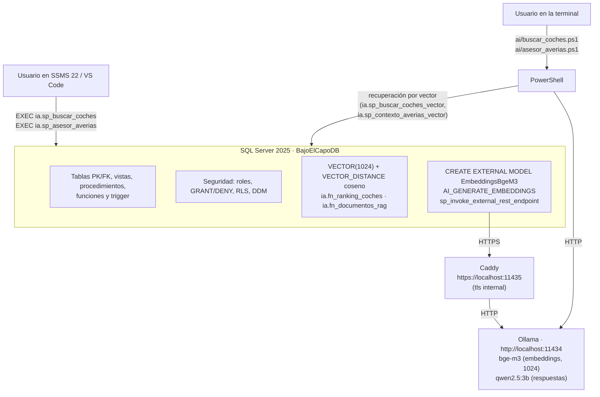
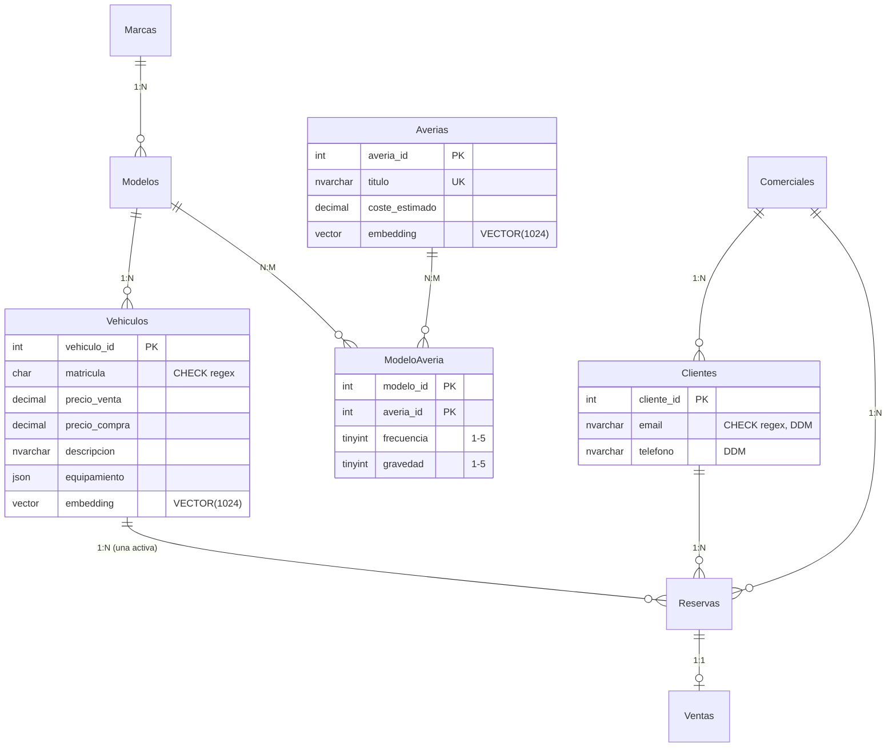

# Bajo el Capó

**Buscador semántico y asesor de averías para un concesionario de coches de segunda mano**,
con SQL Server 2025 en local e IA local con Ollama.

| | |
| --- | --- |
| **Autor** | Emmanuel Grande Sierra |
| **Certificación** | Microsoft DP-800 · SQL AI Developer Associate |
| **Práctica** | Práctica 09 · Mini-proyecto de BD vectoriales |
| **Nivel** | **Nivel 3 (Avanzado)**: Nivel 2 + Vector Search + RAG + modelo local |
| **Entorno** | Windows 11, SQL Server 2025, SSMS 22, Ollama y Caddy. Todo en local, sin Azure ni Fabric |

---

## Índice

1. [Descripción](#descripción)
2. [Arquitectura](#arquitectura)
3. [Tecnologías](#tecnologías)
4. [Instalación](#instalación)
5. [Base de datos](#base-de-datos)
6. [Funcionalidades DP-800 implementadas](#funcionalidades-dp-800-implementadas)
7. [Ejemplos](#ejemplos)
8. [Estrategia de pruebas](#estrategia-de-pruebas)
9. [Solución de problemas](#solución-de-problemas)
10. [Conclusiones](#conclusiones)
11. [Cumplimiento del enunciado](#cumplimiento-del-enunciado)
12. [Estructura del repositorio](#estructura-del-repositorio)

---

## Descripción

**Problema.** Quien compra un coche de segunda mano no sabe qué averías son típicas de cada modelo
ni cuánto cuestan. El concesionario pierde ventas por falta de confianza, o vende coches que luego
generan reclamaciones.

**Solución.** Una base de datos SQL Server 2025 que permite:

- **Buscar coches en lenguaje natural** («familiar, económico y fiable para ciudad y escapadas»),
  aunque la descripción no contenga esas palabras. Se usan embeddings (bge-m3) y distancia coseno.
- **Consultar un asesor de averías (RAG).** Responde con las averías registradas de cada modelo y su
  coste, usando solo datos recuperados de la base de datos (qwen2.5:3b). Si no hay datos, lo dice.
- **Gestionar el negocio con seguridad.** Cada comercial ve solo sus clientes y reservas, con email
  y teléfono enmascarados, y el mecánico no ve datos comerciales.

La búsqueda y el RAG se pueden usar por **dos vías** con la misma lógica de recuperación en T-SQL:
desde **SSMS** (todo dentro de SQL Server) y desde la **terminal** (scripts PowerShell que llaman a
Ollama).

---

## Arquitectura



- **Vía SSMS**: el procedimiento genera el embedding, busca, construye el contexto y llama al
  modelo. SQL Server solo llama a modelos externos por **HTTPS**, por eso pasa por Caddy.
- **Vía terminal**: el script pide el embedding y la respuesta a Ollama directamente y usa SQL
  Server solo para la recuperación. El ranking y el contexto se calculan en T-SQL, igual que en la
  vía SSMS.

**Flujo del RAG.** Pregunta → embedding (bge-m3) → búsqueda vectorial en SQL Server → averías y
coches recuperados → contexto → qwen2.5:3b → respuesta.

| Solo LLM | RAG (SQL Server + Vector Search + contexto + LLM) |
| --- | --- |
| Responde con lo que «recuerda» de su entrenamiento | Responde con los datos recuperados de la base de datos |
| Puede inventar averías o costes | Queda limitado al contexto y dice cuándo no hay datos |
| No conoce el stock ni las averías de Bajo el Capó | Usa el catálogo y las averías registradas |

---

## Tecnologías

Versiones medidas en el equipo de desarrollo.

| Tecnología | Versión | Uso |
| --- | --- | --- |
| SQL Server 2025 | 17.0.1000.7 (RTM) | Base de datos, `VECTOR`, `JSON`, regex, `CREATE EXTERNAL MODEL`, `AI_GENERATE_EMBEDDINGS`, `sp_invoke_external_rest_endpoint` |
| T-SQL | nivel de compatibilidad 170 | Tablas, vistas, procedimientos, funciones, trigger y consultas avanzadas |
| SSMS | 22 | Ejecución de scripts, planes de ejecución, vía SSMS de la IA |
| VS Code + extensión SQL Server | — | Edición y conexión |
| sqlcmd | 17.0.1000.7 | `run_all.ps1` |
| Windows PowerShell | 5.1 | `run_all.ps1` y vía terminal de la IA |
| Ollama | 0.40.11 | bge-m3 (embeddings, 1024 dim.) y qwen2.5:3b (respuestas) |
| Caddy | 2.11.7 | Proxy HTTPS local `https://localhost:11435` → `http://localhost:11434` |
| Claude Code + GitHub Spec Kit | Spec Kit 1.2.6 | Desarrollo asistido por IA guiado por especificaciones (bloque B) |
| Git y GitHub | Git 2.49 | Control de versiones, una rama por feature |
| Mermaid | — | Diagramas de este README |

---

## Instalación

> Requisitos: Windows 11, SQL Server 2025 con autenticación de Windows y permisos de `sysadmin`,
> `sqlcmd`, Git y espacio en disco para los dos modelos de Ollama.

### 1. Clonar el repositorio

```powershell
git clone <URL-del-repositorio> bajo-el-capo
cd bajo-el-capo
```

### 2. Crear la base de datos y ejecutar los tests (sin IA)

```powershell
.\run_all.ps1
```

Recrea `BajoElCapoDB` desde cero (`01` la borra si existe), ejecuta `database/02` a `08` y
`tests/tests.sql`. Debe terminar con:

```text
TESTS: todos los bloques han pasado.
RESULTADO: todos los scripts y tests terminaron sin errores.
```

Parámetros: `-Servidor` (por defecto `localhost`), `-ConIA` y `-Salida <archivo>` para guardar la
salida.

### 3. Instalar Ollama y los modelos

1. Instala Ollama para Windows desde su web oficial.
2. Descarga los modelos:

   ```powershell
   ollama pull bge-m3
   ollama pull qwen2.5:3b
   ollama list
   ```

3. Comprueba que responde: `Invoke-RestMethod http://localhost:11434/api/tags`.

### 4. Configurar Caddy (HTTPS local para SQL Server)

SQL Server 2025 solo llama a modelos externos por HTTPS, y Ollama sirve en HTTP. Caddy hace de
proxy inverso con un certificado local.

1. Instala Caddy para Windows y crea un `Caddyfile` fuera del repositorio con este contenido:

   ```text
   https://localhost:11435 {
       tls internal
       reverse_proxy localhost:11434
   }
   ```

2. Arráncalo desde la carpeta del `Caddyfile`: `caddy run` (o `caddy start` para dejarlo en
   segundo plano).
3. **Confía en el certificado raíz de Caddy en el almacén del equipo local.** El servicio de SQL
   Server no usa el almacén de tu usuario. Desde una consola de administrador: `caddy trust`.
   También puedes importar `root.crt` de la carpeta `pki\authorities\local` de los datos de Caddy
   (en `%APPDATA%\Caddy`) en *Equipo local → Entidades de certificación raíz de confianza* con
   `certlm.msc`.
4. Comprueba que responde: `Invoke-RestMethod https://localhost:11435/api/tags`.

### 5. Crear la base de datos con la parte de IA

```powershell
.\run_all.ps1 -ConIA
```

Además de lo anterior, ejecuta en este orden:

1. `tests/test_conexion_ia.sql` (cadena SQL Server → Caddy → Ollama).
2. `ai/create_external_model.sql`.
3. `ai/generate_embeddings.sql` (228 coches y 57 averías).
4. `ai/vector_search.sql`.
5. `ai/rag.sql`.
6. `tests/tests_ia.sql`.

En el equipo de desarrollo tardó unos 19 s.

### 6. Probar las dos vías

**Vía SSMS** (abre una consulta sobre `BajoElCapoDB`):

```sql
EXEC ia.sp_buscar_coches
     @consulta   = N'familiar, económico y fiable para ciudad y escapadas',
     @precio_max = 14000,
     @top        = 5;

EXEC ia.sp_asesor_averias
     @pregunta = N'¿Qué averías suele tener y cuánto cuesta repararlas?',
     @modelo   = N'Peugeot 308 SW';
```

**Vía terminal** (desde la raíz del repositorio):

```powershell
.\ai\buscar_coches.ps1 -Consulta "familiar, económico y fiable para ciudad y escapadas" -PrecioMax 14000
.\ai\asesor_averias.ps1 -Pregunta "¿Qué averías suele tener y cuánto cuesta repararlas?" -Modelo "Dacia Jogger"
```

### 7. Demostraciones adicionales

```powershell
sqlcmd -S localhost -d BajoElCapoDB -E -C -I -i tests\demo_seguridad.sql   # seguridad con distintos usuarios
.\tests\medir_optimizacion.ps1                                             # planes reales antes/después
```

---

## Base de datos

`BajoElCapoDB` (intercalación `Modern_Spanish_CI_AS`, nivel 170) con cinco esquemas y ningún objeto
en `dbo`: `catalogo`, `taller`, `ventas`, `ia` (procedimientos de IA) y `seg` (predicado de
Row-Level Security).



| Tabla | Filas | Claves y restricciones destacadas |
| --- | --- | --- |
| `catalogo.Marcas` | 8 | `nombre` UNIQUE |
| `catalogo.Modelos` | 24 | FK a Marcas; CHECK de segmento y de años |
| `catalogo.Vehiculos` | 228 | Matrícula con `REGEXP_LIKE`; CHECK de año, km, precios, combustible y estado; `equipamiento` JSON; `embedding` VECTOR(1024) |
| `taller.Averias` | 57 | `titulo` UNIQUE; `embedding` VECTOR(1024) |
| `taller.ModeloAveria` | 207 | PK compuesta; frecuencia y gravedad de 1 a 5. El **Dacia Jogger** no tiene averías (caso de control) |
| `ventas.Comerciales` | 4 | `usuario_bd` UNIQUE (enlaza con RLS) |
| `ventas.Clientes` | 24 | Email con `REGEXP_LIKE` |
| `ventas.Reservas` | 44 | Índice único filtrado: una sola reserva **activa** por coche |
| `ventas.Ventas` | 16 | `reserva_id` UNIQUE (1:1) |

Los recuentos son los que comprueba el bloque C de `tests/tests.sql`
([evidencia](docs/evidencias/001-base-datos.txt)).

---

## Funcionalidades DP-800 implementadas

### Bloque A · Diseño y T-SQL

- ✓ 9 tablas con PK, FK, CHECK, UNIQUE, DEFAULT; relaciones 1:N, N:M y 1:1 · [`02_create_tables.sql`](database/02_create_tables.sql)
- ✓ Datos de prueba de un concesionario grande · [`03_insert_data.sql`](database/03_insert_data.sql)
- ✓ Vistas `vw_catalogo` (sin precio de compra), `vw_averias_por_modelo`, `vw_reservas` · [`04_views.sql`](database/04_views.sql)
- ✓ Funciones `fn_coste_esperado`, `fn_averias_modelo`; procedimientos `sp_registrar_reserva` y `sp_registrar_venta` con transacción, bloqueo y `THROW` 501xx; trigger `tr_reservas_estado` · [`05_procedures.sql`](database/05_procedures.sql)
- ✓ Índices de apoyo a las FK e índice de optimización · [`02`](database/02_create_tables.sql), [`07`](database/07_indexes.sql)
- ✓ Consultas avanzadas: CTE + `ROW_NUMBER`, window functions, consulta correlacionada, JSON (`OPENJSON`, `JSON_OBJECT`, `JSON_ARRAYAGG`) y expresiones regulares (`REGEXP_LIKE`, `REGEXP_REPLACE`) · [`08_advanced_queries.sql`](database/08_advanced_queries.sql)

### Bloque B · Desarrollo asistido por IA

- ✓ Claude Code + GitHub Spec Kit: constitución, y spec, plan y tareas de las 6 features · [`specs/`](specs/), [`.specify/memory/constitution.md`](.specify/memory/constitution.md)
- ✓ 5 casos documentados con prompt, respuesta, partes aceptadas, correcciones y verificación · [`docs/bloque-b.md`](docs/bloque-b.md)
- ✓ Registro de decisiones · [`docs/decisiones.md`](docs/decisiones.md)

### Bloque C · Seguridad (tres mecanismos)

- ✓ Roles `rol_admin`, `rol_comercial`, `rol_mecanico` y `rol_ia_servicio`; usuarios sin inicio de sesión (sin contraseñas); `GRANT`/`DENY` sobre vistas y procedimientos (mínimo privilegio)
- ✓ Row-Level Security con `FILTER` y `BLOCK` en clientes y reservas
- ✓ Dynamic Data Masking en email y teléfono · [`06_security.sql`](database/06_security.sql), [`demo_seguridad.sql`](tests/demo_seguridad.sql)

### Bloque D · Optimización

- ✓ Listado del catálogo con 50.228 coches: Clustered Index Scan → Index Seek con un índice compuesto · [`07_indexes.sql`](database/07_indexes.sql), [tabla antes/después](docs/evidencias/003-optimizacion.md)

### Bloque E · Embeddings

- ✓ `CREATE EXTERNAL MODEL` (Ollama, bge-m3) y `AI_GENERATE_EMBEDDINGS`; 228 coches y 57 averías en `VECTOR(1024)` · [`create_external_model.sql`](ai/create_external_model.sql), [`generate_embeddings.sql`](ai/generate_embeddings.sql)

| Aspecto | Decisión |
| --- | --- |
| Modelo | bge-m3 en Ollama (multilingüe, buen rendimiento en español) |
| Columnas del texto | Coches: marca, modelo, segmento, combustible y descripción. Averías: título, síntoma, causa y solución |
| Dimensión | 1024 (`VECTOR(1024)`) |
| Generación | `ia.sp_generar_embeddings`, por lotes de 25 en transacciones independientes; solo filas con `embedding` NULL |
| Almacenamiento | Columna `embedding VECTOR(1024)` en `catalogo.Vehiculos` y `taller.Averias` |

### Bloque F · Intelligent Search

- ✓ Ranking único `ia.fn_ranking_coches` con filtros de precio, segmento y top; `ia.sp_buscar_coches` (SSMS) e `ia.sp_buscar_coches_vector` + [`buscar_coches.ps1`](ai/buscar_coches.ps1) (terminal) · [`vector_search.sql`](ai/vector_search.sql)
- ✓ **Métrica: distancia coseno** (`VECTOR_DISTANCE('cosine', ...)`, de 0 a 2). Compara la dirección
  de los vectores, es decir, el significado, y no su longitud. bge-m3 está entrenado para medir la
  similitud con el coseno. Con 228 vectores se hace búsqueda exacta. El índice vectorial y
  `VECTOR_SEARCH` siguen en vista previa y quedan como mejora.

### Bloque G · RAG

- ✓ `ia.sp_asesor_averias` (SSMS) y [`asesor_averias.ps1`](ai/asesor_averias.ps1) (terminal) con
  las cuatro partes: pregunta, documentos recuperados, contexto y respuesta. Prompt restrictivo,
  temperatura 0 y caso de control (Dacia Jogger) · [`rag.sql`](ai/rag.sql)
- ✓ Comerciales y mecánicos usan el buscador y el asesor sin permisos sobre el modelo:
  `EXECUTE AS 'ia_servicio'`

---

## Ejemplos

Salidas reales copiadas de [`docs/evidencias/`](docs/evidencias/).

**Las 3 averías más frecuentes de cada modelo (CTE + `ROW_NUMBER`).**

```text
marca modelo posicion titulo frecuencia gravedad
Dacia Duster 1 Ruidos en la suspensión delantera 4 2
Dacia Duster 2 Electroválvula del sistema GLP sucia 3 2
Dacia Duster 3 Óxido en bajos y pasos de rueda 3 2
```

**Seguridad: la misma consulta con distintos usuarios** ([002](docs/evidencias/002-seguridad.txt)).

```text
usuario reservas_visibles clientes_visibles
admin_demo 44 24
comercial_ana 7 6
comercial_luis 8 6
comercial_ana Lucía Ferrer lXXX@XXXX.com XXX-XXX-677
mecanico_demo -> ventas.Clientes: DENEGADO (error 229): Se denegó el permiso SELECT en el objeto 'Clientes' ...
```

**Optimización** ([003](docs/evidencias/003-optimizacion.md)): lecturas lógicas en `Vehiculos`
2.974 → 5; coste estimado del plan 2,41887 → 0,0518114.

**Búsqueda semántica**, frase «familiar, económico y fiable para ciudad y escapadas», precio
máximo 14.000 € ([004](docs/evidencias/004-busqueda.txt)). Ninguna de las cinco descripciones
contiene «familiar», «económico», «fiable» ni «escapadas»:

```text
posicion distancia marca modelo segmento precio_venta descripcion
1 0,4500 Peugeot 308 SW Familiar 8500,00 Pensado para cargar de todo: bicicletas, equipaje y sillas infantiles …
2 0,4569 Toyota Corolla Touring Sports Familiar 10150,00 Maletero enorme y plazas traseras amplias; caben carritos, maletas y l…
3 0,4666 Seat León Compacto 5750,00 Tamaño justo para cinco personas, con maletero práctico y conducción a…
--- Comparación automática (posición, marca, modelo, precio y distancia): MISMO TOP en las dos vías
```

**RAG** ([005](docs/evidencias/005-rag.txt)):

```text
Pregunta: ¿Qué averías suele tener y cuánto cuesta repararlas? (Peugeot 308 SW)
Respuesta: El Peugeot 308 SW suele tener averías como amortiguadores traseros gastados, depósito de
AdBlue averiado, consumo excesivo de aceite, volante bimasa desgastado e una correa de distribución
en el baño de aceite degradada. Las averías más costosas son la correa de distribución, con un costo
estimado de 1800 €, y el depósito de AdBlue, con un costo estimado de 900 €.

Caso de control: misma pregunta sobre el Dacia Jogger (contexto de averías: «(ninguna)»)
Respuesta: No hay averías registradas para ese modelo.
```

---

## Estrategia de pruebas

Cada prueba falla con `THROW` y un código documentado (500xx), y `run_all.ps1` se detiene en el
primer error (`sqlcmd -b`). Si el comando termina, todas las pruebas han pasado.

| Tipo de prueba | Qué comprueba | Dónde | Evidencia |
| --- | --- | --- | --- |
| Estructurales | 9 tablas, reparto por esquema, nada en `dbo` | `tests.sql` A, B | [001](docs/evidencias/001-base-datos.txt) |
| De datos | Recuentos exactos (8, 24, 228, 57, 207, 4, 24, 44, 16) y coherencia coche–reserva–venta | `tests.sql` C, D | [001](docs/evidencias/001-base-datos.txt) |
| De objetos | Vistas y funciones devuelven filas; la vista del catálogo no expone `precio_compra`; el Jogger sin averías | `tests.sql` E | [001](docs/evidencias/001-base-datos.txt) |
| De integración | Flujo reserva → venta con el trigger, y limpieza | `tests.sql` F | [001](docs/evidencias/001-base-datos.txt) |
| Negativas | Doble reserva → 50102; precio inválido → 50113; mecánico → permiso denegado (229); reserva para cliente ajeno → 50103; caso de control del RAG sin averías | `tests.sql` F, G; `tests_ia.sql` K; `demo_seguridad.sql` | [001](docs/evidencias/001-base-datos.txt), [002](docs/evidencias/002-seguridad.txt), [005](docs/evidencias/005-rag.txt) |
| De seguridad | Roles, usuarios sin login, política RLS activa, columnas enmascaradas, filas distintas por comercial | `tests.sql` G | [002](docs/evidencias/002-seguridad.txt) |
| De rendimiento | El índice existe y la carga temporal se borra (228 coches) | `tests.sql` H; `medir_optimizacion.ps1` | [003](docs/evidencias/003-optimizacion.md) |
| De IA | Sin vectores NULL, 1024 dimensiones, ranking con filtros y orden, uso por un comercial; RAG limitado al modelo, uso por un mecánico, caso de control | `tests_ia.sql` I, J, K | [004](docs/evidencias/004-busqueda.txt), [005](docs/evidencias/005-rag.txt) |
| De equivalencia de vías | Mismo top y mismo contexto por SSMS y por terminal (comparación automática) | scripts de evidencia | [004](docs/evidencias/004-busqueda.txt), [005](docs/evidencias/005-rag.txt) |

Criterio del caso de control: la respuesta del Jogger **no cita ningún título de avería** de la
base de datos y expresa que no hay datos («no» + «datos», «información» o «registr»).

Mejora futura: migrar las pruebas a **tSQLt** o a **SQL Database Projects** y ejecutarlas en
integración continua.

---

## Solución de problemas

Problemas reales encontrados durante el desarrollo (detalle en [`docs/decisiones.md`](docs/decisiones.md)
y [`docs/bloque-b.md`](docs/bloque-b.md)):

| Síntoma | Causa | Solución |
| --- | --- | --- |
| `02` falla con el error 1934 (`QUOTED_IDENTIFIER`) al crear el índice filtrado | `sqlcmd` desactiva `QUOTED_IDENTIFIER` por defecto | Usar `sqlcmd -I` (ya incluido en `run_all.ps1`) |
| Acentos rotos («económico») en las frases enviadas desde PowerShell | Windows PowerShell 5.1 lee como ANSI los `.ps1` sin BOM | Guardar los `.ps1` en UTF-8 con BOM |
| La vía SSMS de la IA falla con un error de certificado o conexión | SQL Server no confía en el certificado de Caddy, o Caddy no está arrancado | Arrancar Caddy y confiar en su certificado raíz en el almacén del **equipo local** (paso 4) |
| `sp_invoke_external_rest_endpoint` desactivado | Viene desactivado en SQL Server 2025 | `ai/create_external_model.sql` ejecuta `sp_configure 'external rest endpoint enabled', 1` |
| La primera llamada al chat tarda | Ollama carga el modelo en memoria | El timeout es de 230 s y el modelo externo reintenta (`retry_count`) |
| Error 16007 al repetir `06_security.sql` | `DROP MASKED` se valida al compilar el lote | El script quita las máscaras con SQL dinámico (ya corregido) |

---

## Conclusiones

**Qué se ha aprendido.**

- SQL Server 2025 puede concentrar los datos, la seguridad, los vectores y la recuperación de un RAG
  sin servicios externos: `VECTOR`, `VECTOR_DISTANCE`, `CREATE EXTERNAL MODEL`,
  `AI_GENERATE_EMBEDDINGS` y `sp_invoke_external_rest_endpoint`.
- `EXECUTE AS` permite que los perfiles de negocio usen la IA sin permisos sobre el modelo, y que
  RLS y DDM sigan funcionando a través de vistas y procedimientos.
- Medir con el plan real y `STATISTICS IO` explica el índice mejor que el tiempo: lecturas en
  `Vehiculos` de 2.974 a 5, aunque suben las de `Modelos` y `Marcas` por el bucle anidado.
- Un prompt restrictivo con temperatura 0 basta para que un modelo pequeño (3B) no invente en el
  caso de control.

**Problemas y cómo se resolvieron.** Ver [Solución de problemas](#solución-de-problemas) y los 5
casos de [`docs/bloque-b.md`](docs/bloque-b.md). Ejemplos: `QUOTED_IDENTIFIER` en sqlcmd, la
codificación de PowerShell 5.1, la limpieza de máscaras, una reserva de la demo que se comitió por
un `ROLLBACK` anidado, y un array JSON escapado como texto.

**Mejoras posibles.**

- Índice vectorial (DiskANN) y `VECTOR_SEARCH` cuando salgan de vista previa.
- Búsqueda híbrida (palabras clave + vectores).
- Fragmentar descripciones largas con `AI_GENERATE_CHUNKS`.
- Una interfaz mínima para los comerciales.
- Pruebas con tSQLt en integración continua.

---

## Cumplimiento del enunciado

| Apartado | Requisito | Cumplimiento y evidencia |
| --- | --- | --- |
| 3 | Todo en local, sin secretos en el repositorio | ✓ `localhost`, autenticación de Windows, usuarios sin login; revisión final sin IPs, rutas personales ni contraseñas |
| 4 · A | BD con tablas relacionadas, PK, FK, constraints, índices, datos, vistas, procedimientos, funciones, trigger, consultas avanzadas | ✓ [`database/`](database/), [001](docs/evidencias/001-base-datos.txt) |
| 4 · B | IA como asistente: prompt, respuesta, aceptado, corregido y verificación | ✓ [`docs/bloque-b.md`](docs/bloque-b.md) (5 casos), [`specs/`](specs/) |
| 5 · C | Dos mecanismos de seguridad como mínimo, demostrados con usuarios distintos | ✓ Tres mecanismos · [`06_security.sql`](database/06_security.sql), [002](docs/evidencias/002-seguridad.txt) |
| 6 · D | Plan, scan/seek, costes, lecturas y tiempo, antes y después, con explicación | ✓ [003 (tabla)](docs/evidencias/003-optimizacion.md), [`.sqlplan` antes](docs/evidencias/003-plan-antes.sqlplan) / [después](docs/evidencias/003-plan-despues.sqlplan) |
| 7 · E | Modelo, columnas, dimensión, generación y almacenamiento de embeddings | ✓ [Bloque E](#bloque-e--embeddings), [`generate_embeddings.sql`](ai/generate_embeddings.sql) |
| 8 · F | Ranking por similitud y métrica justificada | ✓ [Bloque F](#bloque-f--intelligent-search), [004](docs/evidencias/004-busqueda.txt) |
| 9 · G | RAG con pregunta, documentos, contexto y respuesta; LLM frente a RAG | ✓ [005](docs/evidencias/005-rag.txt), [Arquitectura](#arquitectura) |
| 10 | Diagrama de arquitectura | ✓ [Arquitectura](#arquitectura) |
| 11 | Repositorio GitHub con estructura | ✓ [Estructura](#estructura-del-repositorio) (falta subirlo: lo hace el autor) |
| 12 | README con todas las secciones | ✓ Este documento |
| 13 | Documento PDF (12 secciones) | ✓ [`docs/proyecto.md`](docs/proyecto.md) (el autor añade las capturas y lo exporta a PDF) |
| 14 | Presentación | Pendiente del autor (`presentation/`) |
| 15 | Entregables: repositorio, README, PDF, PowerPoint, scripts | ✓ Scripts y README; PDF y PowerPoint los prepara el autor |
| 16 | Criterios de evaluación | Cubiertos por los apartados anteriores |
| 17 | Nivel indicado en el README | ✓ **Nivel 3** (cabecera) |
| 18 | Demostrar que funciona: código → ejecución → resultado → explicación | ✓ `run_all.ps1 -ConIA` y [`docs/evidencias/`](docs/evidencias/) |

---

## Estructura del repositorio

```text
bajo-el-capo/
├── README.md
├── CLAUDE.md                     ← instrucciones para Claude Code
├── run_all.ps1                   ← recrea la base y ejecuta los tests (-ConIA)
├── .specify/                     ← Spec Kit (constitución, plantillas y scripts)
├── .claude/skills/               ← comandos de Spec Kit para Claude Code
├── specs/                        ← spec, plan y tareas de las features 001 a 006
├── database/
│   ├── 01_create_database.sql … 08_advanced_queries.sql
├── ai/
│   ├── create_external_model.sql, generate_embeddings.sql, vector_search.sql, rag.sql
│   ├── comun.ps1, buscar_coches.ps1, asesor_averias.ps1
├── tests/
│   ├── tests.sql, tests_ia.sql, test_conexion_ia.sql
│   ├── demo_seguridad.sql, medir_optimizacion.ps1
└── docs/
    ├── proyecto.md               ← informe técnico (se exporta a PDF)
    ├── bloque-b.md, decisiones.md, estado.md
    ├── prompts/                  ← entradas usadas con Spec Kit
    └── evidencias/               ← salidas reales (000 a 005)
```
