# Bajo el Capó

**Buscador semántico y asesor de averías para un concesionario de coches de segunda mano**,
con SQL Server 2025 en local e inteligencia artificial local con Ollama.

| | |
| --- | --- |
| **Autor** | Emmanuel Grande Sierra |
| **Certificación** | Microsoft DP-800 · SQL AI Developer Associate |
| **Práctica** | Práctica 09 · Mini-proyecto de BD vectoriales |
| **Nivel** | **Nivel 3 (Avanzado)**: Nivel 2 + Vector Search + RAG + modelo local |
| **Entorno** | Windows 11, SQL Server 2025, SSMS 22, Ollama y Caddy. Todo en local, sin Azure ni Microsoft Fabric |

Todos los resultados de este documento son **salidas reales** de las ejecuciones del proyecto.
Las salidas completas también se guardan en [`docs/evidencias/`](docs/evidencias/).

---

## Índice

1. [Descripción](#1-descripción)
2. [Arquitectura](#2-arquitectura)
3. [Tecnologías](#3-tecnologías)
4. [Instalación paso a paso](#4-instalación-paso-a-paso)
5. [Los scripts de PowerShell, explicados](#5-los-scripts-de-powershell-explicados)
6. [Cómo usar el buscador y el asesor (RAG)](#6-cómo-usar-el-buscador-y-el-asesor-rag)
7. [Base de datos](#7-base-de-datos)
8. [Funcionalidades DP-800 implementadas](#8-funcionalidades-dp-800-implementadas)
9. [Ejemplos con resultados reales](#9-ejemplos-con-resultados-reales)
10. [Estrategia de pruebas](#10-estrategia-de-pruebas)
11. [Solución de problemas](#11-solución-de-problemas)
12. [Conclusiones](#12-conclusiones)
13. [Estructura del repositorio](#13-estructura-del-repositorio)

---

## 1. Descripción

**El problema.** Quien compra un coche de segunda mano no sabe qué averías son típicas de cada
modelo ni cuánto cuesta repararlas. Muchos anuncios parecen iguales. El concesionario pierde
ventas por falta de confianza, o vende coches que después generan reclamaciones.

**La solución.** Una base de datos SQL Server 2025 que permite:

- **Buscar coches en lenguaje natural.** Por ejemplo: «familiar, económico y fiable para ciudad y
  escapadas». Devuelve coches parecidos en significado aunque su descripción no contenga esas
  palabras. Se usan embeddings (modelo bge-m3) y distancia coseno.
- **Consultar un asesor de averías (RAG).** Responde qué averías suele tener un modelo y cuánto
  cuestan, usando **solo** los datos recuperados de la base de datos (modelo qwen2.5:3b). Si no hay
  datos, lo dice en lugar de inventar.
- **Gestionar el negocio con seguridad.** Cada comercial ve solo sus clientes y sus reservas, con
  el email y el teléfono enmascarados. El mecánico no ve datos comerciales y nadie salvo el
  administrador ve el precio de compra.

El buscador y el asesor se usan por **dos vías** que comparten la misma lógica de recuperación en
T-SQL:

- **SSMS**: todo ocurre dentro de SQL Server.
- **Terminal**: scripts de PowerShell que llaman a Ollama.

---

## 2. Arquitectura

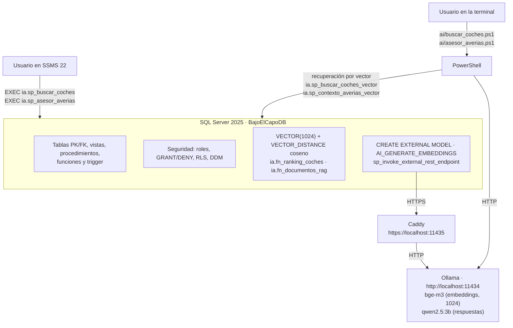

- **Vía SSMS.** El procedimiento genera el embedding de la frase, busca por similitud, construye el
  contexto y llama al modelo de chat. SQL Server 2025 solo llama a modelos externos por **HTTPS**, y
  Ollama sirve en HTTP; por eso entre los dos hay un proxy local, **Caddy**.
- **Vía terminal.** El script pide el embedding y la respuesta a Ollama directamente, y usa SQL
  Server para la recuperación. El ranking y el contexto se calculan en T-SQL con las mismas
  funciones que la vía SSMS, así que las dos vías dan el mismo resultado.

**Flujo del RAG**

```text
Pregunta → Embedding (bge-m3) → Búsqueda vectorial en SQL Server → Averías y coches recuperados
         → Construcción del contexto → qwen2.5:3b → Respuesta
```

**LLM frente a RAG**

| Solo LLM | RAG (SQL Server + Vector Search + contexto + LLM) |
| --- | --- |
| Responde con lo que «recuerda» de su entrenamiento | Responde con los datos recuperados de la base de datos |
| Puede inventar averías o costes | Queda limitado al contexto y dice cuándo no hay datos |
| No conoce el stock ni las averías de Bajo el Capó | Usa el catálogo y las averías registradas |

---

## 3. Tecnologías

Versiones medidas en el equipo de desarrollo.

| Tecnología | Versión | Uso en el proyecto |
| --- | --- | --- |
| Windows 11 | — | Sistema operativo |
| SQL Server 2025 | 17.0.1000.7 (RTM) | Base de datos; tipos `VECTOR` y `JSON`; expresiones regulares; `CREATE EXTERNAL MODEL`, `AI_GENERATE_EMBEDDINGS` y `sp_invoke_external_rest_endpoint` |
| T-SQL | Compatibilidad 170 | Tablas, vistas, procedimientos, funciones, trigger y consultas avanzadas |
| SSMS | 22 | Ejecución de scripts, planes de ejecución y vía SSMS de la IA |
| sqlcmd | 17.0.1000.7 | Lo usa `run_all.ps1` para ejecutar los scripts |
| Windows PowerShell | 5.1 | `run_all.ps1` y vía terminal de la IA |
| Ollama | 0.40.11 | Modelos locales: bge-m3 (embeddings, 1024 dimensiones) y qwen2.5:3b (respuestas) |
| Caddy | 2.11.7 | Proxy HTTPS local: `https://localhost:11435` → `http://localhost:11434` |
| VS Code | — | Edición de scripts |
| Git y GitHub | Git 2.49 | Control de versiones y publicación |
| Mermaid | — | Diagramas de este README |

---

## 4. Instalación paso a paso

> **Requisitos**:
>
> - Windows 11.
> - SQL Server 2025 con autenticación de Windows; tu usuario debe ser `sysadmin`.
> - `sqlcmd` (viene con SQL Server y con SSMS 22).
> - Git.
> - Espacio en disco para los dos modelos de Ollama.
>
> Todos los comandos se ejecutan en **PowerShell**, desde la carpeta raíz del repositorio.

### Paso 1 · Descargar el repositorio

```powershell
git clone <URL-del-repositorio> bajo-el-capo
cd bajo-el-capo
```

Si Windows no deja ejecutar scripts (`...no está firmado digitalmente` o `la ejecución de scripts
está deshabilitada`), permítelos **solo para la consola actual**. No cambia nada del sistema:

```powershell
Set-ExecutionPolicy -Scope Process -ExecutionPolicy Bypass
```

### Paso 2 · Crear la base de datos y comprobarla (sin IA)

```powershell
.\run_all.ps1
```

Este comando borra y recrea `BajoElCapoDB` desde cero, ejecuta los scripts de `database/` y los
tests (ver la [sección 5.1](#51-run_allps1--recrear-todo-y-ejecutar-los-tests)). Así termina la
salida real:

```text
OK A: las 9 tablas existen y no hay objetos en dbo
OK B: tablas por esquema correctas
OK C: los 9 recuentos coinciden con 03_insert_data.sql
OK D: coches, reservas y ventas coherentes
OK E: vistas y funciones devuelven filas; el Dacia Jogger no tiene averías
OK F2: doble reserva rechazada con el error 50102
OK F: reserva, doble reserva, venta y limpieza correctas
OK G: roles, RLS, DDM y permisos denegados correctos
OK H: índice de optimización creado y 228 coches tras borrar la carga
TESTS: todos los bloques han pasado.
RESULTADO: todos los scripts y tests terminaron sin errores.
```

Con esto ya funciona toda la parte que no usa IA: diseño, T-SQL, seguridad y optimización.

### Paso 3 · Instalar Ollama y descargar los modelos

1. Descarga e instala Ollama para Windows desde su web oficial. Queda en marcha en segundo plano;
   si no, ejecuta `ollama serve` en otra consola.
2. Descarga los dos modelos:

   ```powershell
   ollama pull bge-m3
   ollama pull qwen2.5:3b
   ollama list
   ```

3. Comprueba que responde:

   ```powershell
   (Invoke-RestMethod http://localhost:11434/api/tags).models.name
   ```

   La lista debe incluir `bge-m3:latest` y `qwen2.5:3b`.

### Paso 4 · Configurar Caddy (HTTPS local para SQL Server)

SQL Server 2025 solo llama a modelos externos por HTTPS. Caddy recibe en
`https://localhost:11435` y reenvía a Ollama en `http://localhost:11434` con un certificado local.

1. Descarga Caddy para Windows (`caddy.exe`) desde su web oficial y ponlo en una carpeta fuera
   del repositorio.
2. En esa carpeta, crea un archivo llamado `Caddyfile` (sin extensión) con este contenido:

   ```text
   https://localhost:11435 {
       tls internal
       reverse_proxy localhost:11434
   }
   ```

3. Arráncalo desde esa carpeta:

   ```powershell
   caddy start      # en segundo plano (o «caddy run» para verlo en primer plano)
   ```

4. **Haz que el equipo confíe en el certificado de Caddy.** El servicio de SQL Server usa el
   almacén de certificados del **equipo local**, no el de tu usuario. Abre una consola **como
   administrador** en la carpeta de Caddy y ejecuta:

   ```powershell
   caddy trust
   ```

   Si SQL Server sigue sin confiar, importa a mano el certificado raíz:

   - Ábrelo en `%APPDATA%\Caddy\pki\authorities\local\root.crt`.
   - Ejecuta `certlm.msc` e impórtalo en *Entidades de certificación raíz de confianza →
     Certificados*.
   - Reinicia el servicio de SQL Server.

5. Comprueba que responde por HTTPS:

   ```powershell
   (Invoke-RestMethod https://localhost:11435/api/tags).models.name
   ```

### Paso 5 · Comprobar la conexión SQL Server → Caddy → Ollama

```powershell
sqlcmd -S localhost -d BajoElCapoDB -E -C -b -I -f 65001 -i tests\test_conexion_ia.sql
```

Este script:

- activa las llamadas REST en SQL Server;
- pide un embedding por HTTPS;
- crea un modelo externo de prueba y genera un vector con `AI_GENERATE_EMBEDDINGS`;
- pide una respuesta al modelo de chat.

Salida real:

```text
rc_http dimensiones
------- -----------
0 1024
dimensiones
-----------
1024
rc_http respuesta_del_modelo
------- --------------------
0 funciona
Conexión SQL Server -> Caddy -> Ollama verificada.
```

`rc_http = 0` significa que la llamada HTTPS devolvió un código 2xx.

*SSMS · prueba de conexión SQL Server → Caddy → Ollama (tests/test_conexion_ia.sql)*

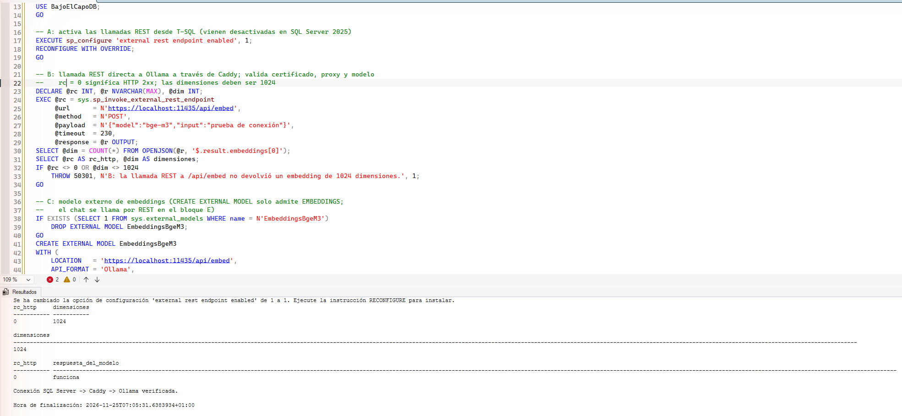

### Paso 6 · Crear la base de datos con la parte de IA

```powershell
.\run_all.ps1 -ConIA
```

Hace todo lo del paso 2 y, además:

1. Comprueba la conexión (`tests/test_conexion_ia.sql`).
2. Crea el modelo externo (`ai/create_external_model.sql`).
3. Genera los embeddings de los 228 coches y las 57 averías (`ai/generate_embeddings.sql`).
4. Crea el buscador (`ai/vector_search.sql`) y el asesor (`ai/rag.sql`).
5. Ejecuta los tests de IA (`tests/tests_ia.sql`).

Final de la salida real (en el equipo de desarrollo tardó unos 19 segundos):

```text
=== ai\generate_embeddings.sql
--- OK ai\generate_embeddings.sql (5.5 s)
=== ai\vector_search.sql
--- OK ai\vector_search.sql (0.3 s)
=== ai\rag.sql
--- OK ai\rag.sql (2 s)
...
OK I: 228 coches y 57 averías con embedding de 1024 dimensiones
OK J: buscador con top, filtros, orden por distancia y uso por un comercial
Respuesta del caso de control: No hay averías registradas para ese modelo.
OK K: RAG con recuperación por modelo, uso por un mecánico y caso de control sin inventar
--- OK tests\tests_ia.sql (1.5 s)
RESULTADO: todos los scripts y tests terminaron sin errores.
```

### Paso 7 · Usar el buscador y el asesor

Consulta la [sección 6](#6-cómo-usar-el-buscador-y-el-asesor-rag).

### Al empezar cada sesión

Antes de usar la parte de IA, comprueba que Ollama y Caddy siguen en marcha:

```powershell
(Invoke-RestMethod http://localhost:11434/api/tags).models.name    # Ollama
(Invoke-RestMethod https://localhost:11435/api/tags).models.name   # Caddy
```

Si falla el segundo, vuelve a arrancar Caddy desde su carpeta con `caddy start`.

---

## 5. Los scripts de PowerShell, explicados

| Script | Para qué sirve | ¿Se ejecuta directamente? |
| --- | --- | --- |
| `run_all.ps1` | Recrea la base de datos y ejecuta todos los tests | Sí |
| `ai/comun.ps1` | Funciones compartidas para hablar con Ollama y con SQL Server | No: lo cargan los otros dos |
| `ai/buscar_coches.ps1` | Buscador semántico desde la terminal | Sí |
| `ai/asesor_averias.ps1` | Asesor de averías (RAG) desde la terminal | Sí |
| `tests/medir_optimizacion.ps1` | Mide la consulta antes y después del índice y guarda los planes reales | Sí |

Todos usan autenticación de Windows contra `localhost`: no hay usuarios ni contraseñas en ningún
script.

### 5.1 `run_all.ps1` · Recrear todo y ejecutar los tests

```powershell
.\run_all.ps1                                             # base de datos + tests
.\run_all.ps1 -ConIA                                      # + modelo externo, embeddings, buscador, RAG y tests de IA
.\run_all.ps1 -ConIA -Salida docs\evidencias\salida.txt   # además guarda la salida en un archivo
.\run_all.ps1 -Servidor localhost\SQL2025                 # otra instancia (por defecto: localhost)
```

| Parámetro | Valor por defecto | Significado |
| --- | --- | --- |
| `-Servidor` | `localhost` | Instancia de SQL Server |
| `-ConIA` | desactivado | Añade la parte de IA (necesita Ollama y Caddy) |
| `-Salida` | ninguno | Archivo donde copiar toda la salida (ruta relativa a la raíz) |

Qué hace, en orden:

1. Ejecuta `database/01_create_database.sql` contra `master`. **Borra `BajoElCapoDB` si existe** y
   la crea con sus cinco esquemas.
2. Ejecuta, contra `BajoElCapoDB`, los scripts de `database/` del `02` al `08`:
   - `02`: tablas.
   - `03`: datos.
   - `04`: vistas.
   - `05`: funciones, procedimientos y trigger.
   - `06`: seguridad.
   - `07`: optimización.
   - `08`: consultas avanzadas.
3. Solo con `-ConIA`: `tests/test_conexion_ia.sql` y después los cuatro scripts de `ai/`.
4. Ejecuta `tests/tests.sql` y, con `-ConIA`, `tests/tests_ia.sql`.

Cada script se lanza con `sqlcmd -S <servidor> -d <base> -E -C -b -I -W -f 65001 -i <script>`:

| Opción | Para qué |
| --- | --- |
| `-E` | Autenticación de Windows |
| `-C` | Confía en el certificado de la instancia local |
| `-b` | Devuelve un código de error si el script falla |
| `-I` | Activa `QUOTED_IDENTIFIER`, necesario para el índice filtrado de `02` |
| `-W` | Quita los espacios de relleno de la salida |
| `-f 65001` | Lee los scripts en UTF-8 (acentos y «ñ») |

Comportamiento:

- Si un script falla, `run_all.ps1` escribe `*** ERROR en <script>` y **se detiene**.
- Los scripts vacíos se omiten.
- Al final escribe `RESULTADO: todos los scripts y tests terminaron sin errores.`
- Sustituye el nombre del equipo por `<equipo>`, para que no aparezca en las salidas guardadas.

### 5.2 `ai/comun.ps1` · Funciones compartidas (no se ejecuta solo)

`buscar_coches.ps1` y `asesor_averias.ps1` lo cargan con `. (Join-Path $PSScriptRoot 'comun.ps1')`.
Define cuatro funciones:

| Función | Qué hace |
| --- | --- |
| `Invoke-Ollama $Ruta $Cuerpo` | Envía un POST JSON a `http://localhost:11434` con UTF-8 en los dos sentidos (así no se rompen los acentos en PowerShell 5.1). Si Ollama no responde, da un error claro: «No se pudo llamar a Ollama…» |
| `Get-VectorJson $Texto` | Pide a bge-m3 (`/api/embed`) el embedding del texto. Comprueba que tiene **1024** valores y lo devuelve como array JSON (`[0.012,-0.034,...]`), el formato que SQL Server convierte a `VECTOR(1024)` |
| `Get-RespuestaChat $Sistema $Usuario` | Pide a qwen2.5:3b (`/api/chat`) una respuesta con **temperatura 0** y sin streaming, y devuelve el texto |
| `Invoke-Procedimiento $Servidor $Nombre $Parametros` | Ejecuta un procedimiento de `BajoElCapoDB` con parámetros de verdad (el vector, de unos 20.000 caracteres, viaja como parámetro y no en la línea de comandos) y devuelve todos sus conjuntos de resultados |

### 5.3 `ai/buscar_coches.ps1` · Buscador desde la terminal

```powershell
.\ai\buscar_coches.ps1 -Consulta "familiar, económico y fiable para ciudad y escapadas" -PrecioMax 14000
.\ai\buscar_coches.ps1 -Consulta "aventura por caminos de tierra" -Segmento SUV -Top 3
```

| Parámetro | Obligatorio | Significado |
| --- | --- | --- |
| `-Consulta` | Sí | Frase en lenguaje natural |
| `-PrecioMax` | No | Precio máximo en euros |
| `-Segmento` | No | `Utilitario`, `Compacto`, `Berlina`, `Familiar`, `SUV`, `Monovolumen` o `Deportivo` |
| `-Top` | No (5) | Número de resultados |
| `-Servidor` | No (`localhost`) | Instancia de SQL Server |

Qué hace, paso a paso:

1. **Embedding de la frase.** Llama a `Get-VectorJson`, que pide a Ollama el vector de 1024
   valores.
2. **Ranking en SQL Server.** Llama a `ia.sp_buscar_coches_vector` pasando el vector y los
   filtros. Ese procedimiento usa la función `ia.fn_ranking_coches`, la misma que la vía SSMS:
   distancia coseno, solo coches disponibles, ordenados de más a menos parecidos.
3. **Resultado.** Muestra una tabla con posición, distancia, marca, modelo, segmento, año, precio
   y el principio de la descripción.

Requisitos: haber ejecutado `.\run_all.ps1 -ConIA` y tener **Ollama** en marcha. Caddy no hace
falta para esta vía.

### 5.4 `ai/asesor_averias.ps1` · Asesor de averías (RAG) desde la terminal

```powershell
.\ai\asesor_averias.ps1 -Pregunta "¿Qué averías suele tener y cuánto cuesta repararlas?" -Modelo "Peugeot 308 SW"
.\ai\asesor_averias.ps1 -Pregunta "Al acelerar noto tirones y el embrague patina, ¿qué puede ser?"
```

| Parámetro | Obligatorio | Significado |
| --- | --- | --- |
| `-Pregunta` | Sí | Pregunta en lenguaje natural |
| `-Modelo` | No | Limita las averías a un modelo: `"Peugeot 308 SW"`, `"308 SW"`, `"Dacia Jogger"`… Sin él, busca entre todas las averías |
| `-Top` | No (5) | Número de averías que se recuperan |
| `-Servidor` | No (`localhost`) | Instancia de SQL Server |

Qué hace, paso a paso:

1. **Recuperación.** Pide a Ollama el embedding de la pregunta. Después llama a
   `ia.sp_contexto_averias_vector`, que devuelve dos cosas:
   - los **documentos recuperados**: las averías más cercanas (del modelo, si se indica) y tres
     coches disponibles parecidos;
   - el **prompt de sistema** y el **contexto** ya construidos en T-SQL, idénticos a los de la vía
     SSMS.
2. **Generación.** Envía el prompt y el contexto a qwen2.5:3b con `Get-RespuestaChat`
   (temperatura 0).
3. **Resultado.** Muestra las cuatro partes del RAG con encabezados:
   - `=== 1. Pregunta ===`
   - `=== 2. Documentos recuperados ===`
   - `=== 3. Contexto enviado al modelo ===`
   - `=== 4. Respuesta ===`

Requisitos: `.\run_all.ps1 -ConIA` ejecutado y **Ollama** en marcha. Caddy no hace falta para esta
vía.

### 5.5 `tests/medir_optimizacion.ps1` · Medir la optimización

```powershell
.\tests\medir_optimizacion.ps1
```

Ejecuta `database/07_indexes.sql` lote a lote en una sola conexión:

1. Carga 50.000 coches de prueba.
2. Activa el plan de ejecución real (`SET STATISTICS XML ON`) solo en las consultas medidas.
3. Guarda los mensajes de `STATISTICS IO` y `TIME`.
4. Al final borra la carga.

Genera estos archivos en `docs/evidencias/`:

- `003-plan-antes.sqlplan` y `003-plan-despues.sqlplan`: se abren en SSMS y muestran el plan
  gráfico.
- `003-optimizacion.txt`: lecturas lógicas, tiempos y un resumen de cada plan.

La base queda como estaba, con 228 coches. Los resultados están en la
[sección 9.4](#94-optimización-bloque-d).

---

## 6. Cómo usar el buscador y el asesor (RAG)

Antes de empezar:

- Haber ejecutado `.\run_all.ps1 -ConIA`.
- Ollama en marcha.
- Para la vía SSMS, también Caddy en marcha.

### 6.1 Vía SSMS (script de SQL)

1. Abre **SSMS 22** y conéctate:
   - Servidor: `localhost`.
   - Autenticación: *Autenticación de Windows*.
   - Marca *Certificado de servidor de confianza*.
2. Abre una consulta nueva sobre la base `BajoElCapoDB` (o empieza con `USE BajoElCapoDB;`).
3. **Buscador.** Ejecuta, por ejemplo:

   ```sql
   EXEC ia.sp_buscar_coches
        @consulta   = N'familiar, económico y fiable para ciudad y escapadas',
        @precio_max = 14000,     -- opcional
        @segmento   = NULL,      -- opcional: N'SUV', N'Familiar', ...
        @top        = 5;         -- opcional
   ```

   Devuelve el ranking: posición, distancia, marca, modelo, segmento, año, kilómetros,
   combustible, precio y descripción.

4. **Asesor (RAG).** Ejecuta:

   ```sql
   EXEC ia.sp_asesor_averias
        @pregunta = N'¿Qué averías suele tener y cuánto cuesta repararlas?',
        @modelo   = N'Peugeot 308 SW';   -- opcional
   ```

   Devuelve **cuatro conjuntos de resultados**:

   1. La pregunta.
   2. Los documentos recuperados.
   3. El prompt de sistema y el contexto enviado al modelo.
   4. La respuesta.

   Si solo quieres el texto de la respuesta en una variable:

   ```sql
   DECLARE @r NVARCHAR(MAX);
   EXEC ia.sp_asesor_averias @pregunta = N'¿Qué averías suele tener?', @modelo = N'Dacia Jogger',
        @respuesta = @r OUTPUT;
   SELECT @r AS respuesta;
   ```

5. **Probarlo como otro usuario.** Un comercial o un mecánico puede usar la IA sin permisos sobre
   el modelo externo:

   ```sql
   EXECUTE AS USER = N'mecanico_demo';
   EXEC ia.sp_asesor_averias @pregunta = N'¿Qué averías suele tener?', @modelo = N'Ford Focus';
   REVERT;
   ```

> Escribe las frases con el prefijo `N'...'` para que se conserven los acentos. La primera llamada
> puede tardar unos segundos porque Ollama carga el modelo en memoria.

### 6.2 Vía terminal (PowerShell)

Desde la raíz del repositorio:

```powershell
# Buscador
.\ai\buscar_coches.ps1 -Consulta "familiar, económico y fiable para ciudad y escapadas" -PrecioMax 14000

# Asesor (RAG)
.\ai\asesor_averias.ps1 -Pregunta "¿Qué averías suele tener y cuánto cuesta repararlas?" -Modelo "Peugeot 308 SW"

# Caso de control: un modelo sin averías registradas
.\ai\asesor_averias.ps1 -Pregunta "¿Qué averías suele tener y cuánto cuesta repararlas?" -Modelo "Dacia Jogger"
```

### 6.3 Preguntas que puedes probar

| Tipo | Frase o pregunta | Qué se espera |
| --- | --- | --- |
| Buscador | `familiar, económico y fiable para ciudad y escapadas` (precio máx. 14000) | Peugeot 308 SW, Toyota Corolla Touring Sports, Seat León |
| Buscador | `coche cómodo para viajes largos por autopista` | Seat León, Seat Ateca, Volkswagen Passat |
| Buscador | `aventura por caminos de tierra y fines de semana en el campo` (segmento SUV) | Seat Ateca, Dacia Duster, Ford Kuga |
| Asesor | `¿Qué averías suele tener y cuánto cuesta repararlas?` con modelo `Peugeot 308 SW` | Averías del 308 SW con sus costes |
| Asesor | `Al acelerar noto tirones y el embrague patina, ¿qué puede ser y cuánto cuesta arreglarlo?` | Averías de embrague (Powershift, DSG7) |
| Control | `¿Qué averías suele tener y cuánto cuesta repararlas?` con modelo `Dacia Jogger` | «No hay averías registradas para ese modelo.» |

Modelos disponibles en el catálogo:

| Marca | Modelos |
| --- | --- |
| Seat | Ibiza, León, Ateca |
| Volkswagen | Polo, Golf, Passat |
| Renault | Clio, Mégane, Scénic |
| Peugeot | 208, 308 SW, 3008 |
| Toyota | Yaris, Corolla Touring Sports, C-HR |
| Ford | Fiesta, Focus, Kuga |
| Dacia | Sandero, Duster, Jogger |
| Kia | Ceed, Sportage, Stinger |

Para ver la lista exacta: `SELECT marca, modelo FROM catalogo.vw_catalogo GROUP BY marca, modelo;`

---

## 7. Base de datos

`BajoElCapoDB`, con intercalación `Modern_Spanish_CI_AS` y nivel de compatibilidad 170 (necesario
para regex, `VECTOR` y `JSON`). Tiene cinco esquemas y ningún objeto en `dbo`:

| Esquema | Contenido |
| --- | --- |
| `catalogo` | Marcas, modelos y vehículos |
| `taller` | Averías y su relación con los modelos |
| `ventas` | Comerciales, clientes, reservas y ventas |
| `ia` | Buscador y asesor |
| `seg` | Seguridad a nivel de fila |

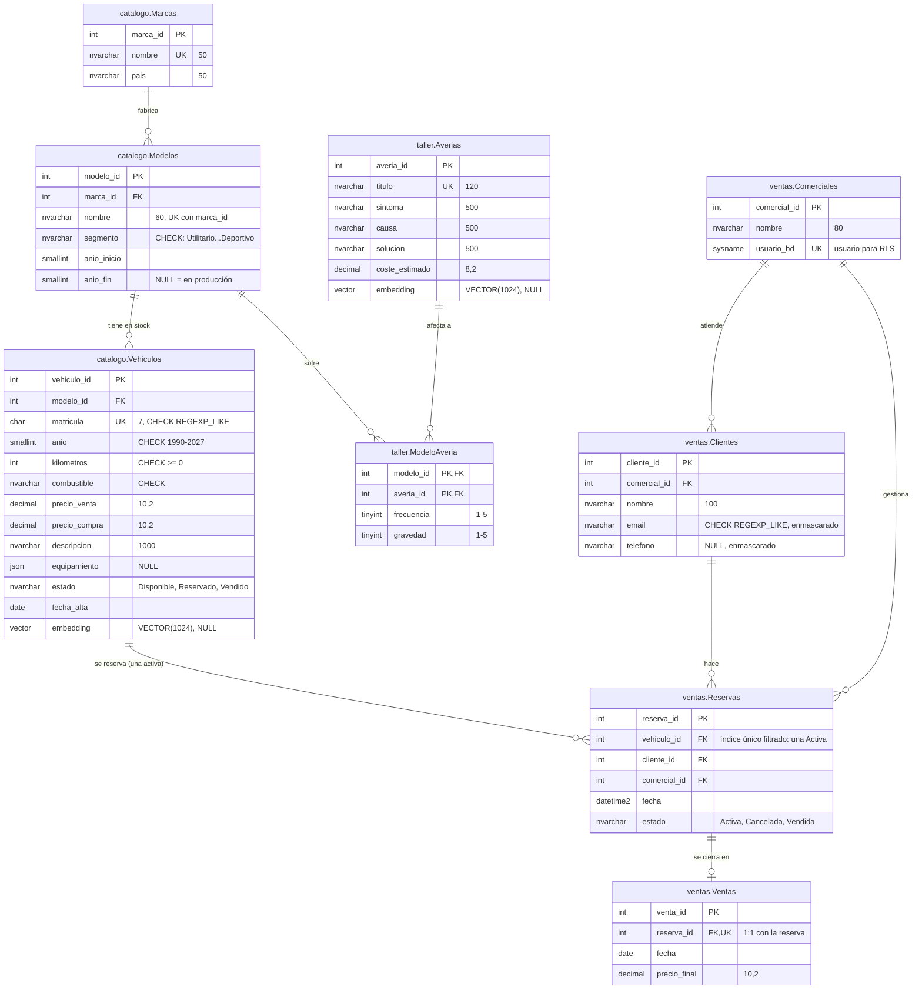

| Tabla | Filas | Claves y restricciones destacadas |
| --- | --- | --- |
| `catalogo.Marcas` | 8 | `nombre` UNIQUE |
| `catalogo.Modelos` | 24 | FK a Marcas; CHECK de segmento y de años |
| `catalogo.Vehiculos` | 228 | Matrícula validada con `REGEXP_LIKE`; CHECK de año, km, precios, combustible y estado; `equipamiento` en JSON; `embedding VECTOR(1024)` |
| `taller.Averias` | 57 | `titulo` UNIQUE; coste estimado; `embedding VECTOR(1024)` |
| `taller.ModeloAveria` | 207 | PK compuesta; frecuencia y gravedad de 1 a 5. El **Dacia Jogger** no tiene ninguna (caso de control) |
| `ventas.Comerciales` | 4 | `usuario_bd` UNIQUE: enlaza cada comercial con su usuario de base de datos (RLS) |
| `ventas.Clientes` | 24 | Email validado con `REGEXP_LIKE`; cada cliente tiene un comercial |
| `ventas.Reservas` | 44 | Índice único filtrado: solo una reserva **activa** por coche |
| `ventas.Ventas` | 16 | `reserva_id` UNIQUE (1:1 con la reserva) |

| Relación | Cardinalidad |
| --- | --- |
| Marcas → Modelos → Vehículos | 1:N |
| Modelos ↔ Averías | N:M (a través de `ModeloAveria`) |
| Comerciales → Clientes → Reservas | 1:N |
| Vehículos → Reservas | 1:N (una sola activa a la vez) |
| Reservas → Ventas | 1:1 |

**Datos cargados.** Salida real de `03_insert_data.sql`:

```text
tabla filas
----- -----
Marcas 8
Modelos 24
Vehiculos 228
Averias 57
ModeloAveria 207
Comerciales 4
Clientes 24
Reservas 44
Ventas 16
estado coches
------ ------
Disponible 194
Reservado 18
Vendido 16
Datos de prueba cargados correctamente.
```

*SSMS · filas por tabla*

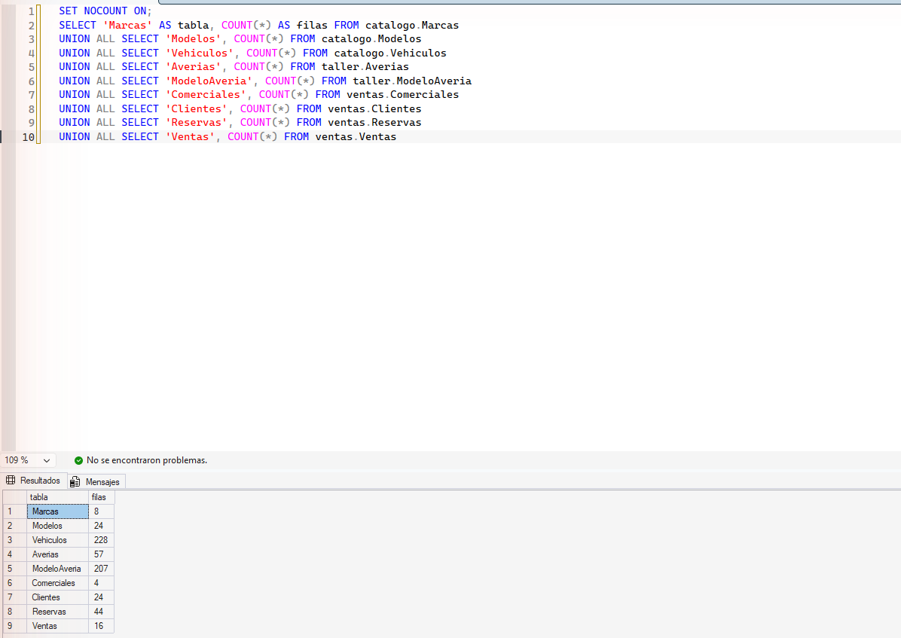

**Objetos de programación**

| Tipo | Objeto | Qué hace |
| --- | --- | --- |
| Vista | `catalogo.vw_catalogo` | Catálogo con marca y modelo; **nunca** muestra el precio de compra |
| Vista | `taller.vw_averias_por_modelo` | Averías de cada modelo con riesgo = frecuencia × gravedad |
| Vista | `ventas.vw_reservas` | Reservas con coche, cliente y comercial (respeta RLS y máscaras) |
| Función | `taller.fn_coste_esperado` | Coste de mantenimiento esperado de un modelo |
| Función | `taller.fn_averias_modelo` | Averías de un modelo (función de tabla) |
| Procedimiento | `ventas.sp_registrar_reserva` | Reserva con bloqueo del coche; errores 50101–50103 |
| Procedimiento | `ventas.sp_registrar_venta` | Cierra la venta de una reserva activa; errores 50111–50113 |
| Trigger | `ventas.tr_reservas_estado` | Recalcula el estado del coche (Disponible, Reservado o Vendido) |
| IA | `ia.sp_generar_embeddings` | Rellena los vectores que faltan |
| IA | `ia.fn_ranking_coches` | Ranking por distancia coseno, compartido por las dos vías |
| IA | `ia.sp_buscar_coches` / `ia.sp_buscar_coches_vector` | Buscador por SSMS / por terminal |
| IA | `ia.sp_asesor_averias` / `ia.sp_contexto_averias_vector` | Asesor RAG por SSMS / recuperación para la terminal |

---

## 8. Funcionalidades DP-800 implementadas

### Bloque A · Diseño de la base de datos y T-SQL

- ✓ Diseño de base de datos: 9 tablas relacionadas con relaciones 1:N, N:M y 1:1 ·
  [`02_create_tables.sql`](database/02_create_tables.sql)
- ✓ PRIMARY KEY, FOREIGN KEY, CHECK, UNIQUE y DEFAULT; tipos `VECTOR` y `JSON`
- ✓ Índices: de apoyo a las FK, único filtrado y de optimización ·
  [`02`](database/02_create_tables.sql), [`07`](database/07_indexes.sql)
- ✓ Datos de prueba: 228 coches, 57 averías, 207 relaciones… ·
  [`03_insert_data.sql`](database/03_insert_data.sql)
- ✓ Views · [`04_views.sql`](database/04_views.sql)
- ✓ Stored Procedures, Functions y Trigger, con transacciones, `TRY/CATCH` y `THROW` ·
  [`05_procedures.sql`](database/05_procedures.sql)
- ✓ Consultas avanzadas: CTE, Window Functions, consulta correlacionada, JSON y expresiones
  regulares · [`08_advanced_queries.sql`](database/08_advanced_queries.sql)

### Bloque B · Desarrollo asistido por IA

- ✓ Se usó un asistente de IA (Claude, en el chat), principalmente para **generar los datos de
  prueba** y para la **planificación general** del proyecto: alcance, modelo de datos, orden de
  trabajo y estrategia de pruebas.
- ✓ Están documentados el prompt, la respuesta, las partes aceptadas, las corregidas y cómo se
  verificó · [`docs/bloque-b.md`](docs/bloque-b.md)

### Bloque C · Seguridad (tres mecanismos)

- ✓ Usuarios y roles: `rol_admin`, `rol_comercial`, `rol_mecanico` y `rol_ia_servicio`. Los
  usuarios de demostración no tienen inicio de sesión, así que no hay contraseñas.
- ✓ Permisos con `GRANT` y `DENY` siguiendo el principio de mínimo privilegio: se accede por vistas
  y procedimientos, no a las tablas.
- ✓ Row-Level Security: cada comercial solo ve sus clientes y sus reservas.
- ✓ Dynamic Data Masking: email y teléfono enmascarados.
- Scripts: [`06_security.sql`](database/06_security.sql) y la demostración
  [`demo_seguridad.sql`](tests/demo_seguridad.sql).

### Bloque D · Optimización

- ✓ Execution plan, Table/Index Scan frente a Index Seek, costes, lecturas lógicas y tiempo, antes
  y después de un índice compuesto · [`07_indexes.sql`](database/07_indexes.sql)

### Bloque E · Embeddings

- ✓ Modelo local bge-m3 con `CREATE EXTERNAL MODEL` y `AI_GENERATE_EMBEDDINGS`; vectores guardados
  en `VECTOR(1024)` · [`create_external_model.sql`](ai/create_external_model.sql),
  [`generate_embeddings.sql`](ai/generate_embeddings.sql)

| Pregunta del enunciado | Respuesta |
| --- | --- |
| ¿Qué modelo se usa? | **bge-m3** en Ollama: multilingüe y con buen rendimiento en español |
| ¿Qué columnas forman el embedding? | Coches: marca, modelo, segmento, combustible y descripción. Averías: título, síntoma, causa y solución |
| ¿Qué dimensión tiene el vector? | **1024** |
| ¿Cómo se generan? | `ia.sp_generar_embeddings` llama a `AI_GENERATE_EMBEDDINGS(texto USE MODEL EmbeddingsBgeM3)` por lotes de 25 filas; solo procesa las que aún no tienen vector |
| ¿Cómo se almacenan? | En la columna `embedding VECTOR(1024)` de `catalogo.Vehiculos` y de `taller.Averias` |

### Bloque F · Intelligent Search (Vector Search)

- ✓ Ranking por similitud con filtros de precio, segmento y número de resultados, por dos vías
  (SSMS y terminal) · [`vector_search.sql`](ai/vector_search.sql),
  [`buscar_coches.ps1`](ai/buscar_coches.ps1)
- ✓ **Métrica justificada: distancia coseno** (`VECTOR_DISTANCE('cosine', ...)`, de 0 a 2):
  - Compara la **dirección** de los vectores, que es lo que codifica el significado, y no su
    longitud.
  - bge-m3 está entrenado para medir la similitud con el coseno.
  - Con 228 vectores, la búsqueda exacta es inmediata. El índice vectorial (`VECTOR_SEARCH`)
    sigue en vista previa en SQL Server 2025 y queda como mejora.

### Bloque G · RAG

- ✓ Asesor de averías con las cuatro partes visibles (pregunta, documentos recuperados, contexto y
  respuesta), por dos vías · [`rag.sql`](ai/rag.sql),
  [`asesor_averias.ps1`](ai/asesor_averias.ps1)
- ✓ Prompt restrictivo («Responde solo con el contexto proporcionado. Si no hay datos suficientes,
  dilo»), temperatura 0 y caso de control con un modelo sin averías.
- ✓ Comerciales y mecánicos lo usan sin permisos sobre el modelo, gracias a
  `EXECUTE AS 'ia_servicio'`.

### Resumen

```text
✓ Diseño de base de datos          ✓ Seguridad (roles, GRANT/DENY, RLS, DDM)
✓ Views                            ✓ Optimización (índice compuesto, plan real)
✓ Stored Procedures                ✓ Embeddings (bge-m3, VECTOR(1024))
✓ Functions y Trigger              ✓ Vector Search (distancia coseno)
✓ CTE, Window Functions, JSON,     ✓ RAG con modelo local (qwen2.5:3b)
  regex y consulta correlacionada  ✓ Desarrollo asistido por IA documentado
```

---

## 9. Ejemplos con resultados reales

### 9.1 Consultas avanzadas (bloque A)

**CTE + `ROW_NUMBER`: las 3 averías más frecuentes de cada modelo** (69 filas; primeras 10):

```sql
WITH ranking AS (
    SELECT marca, modelo, titulo, frecuencia, gravedad,
           ROW_NUMBER() OVER (PARTITION BY modelo_id ORDER BY frecuencia DESC, gravedad DESC) AS posicion
    FROM taller.vw_averias_por_modelo)
SELECT marca, modelo, posicion, titulo, frecuencia, gravedad FROM ranking WHERE posicion <= 3;
```

```text
marca modelo posicion titulo frecuencia gravedad
Dacia Duster 1 Ruidos en la suspensión delantera 4 2
Dacia Duster 2 Electroválvula del sistema GLP sucia 3 2
Dacia Duster 3 Óxido en bajos y pasos de rueda 3 2
Dacia Sandero 1 Electroválvula del sistema GLP sucia 3 2
Dacia Sandero 2 Óxido en bajos y pasos de rueda 3 2
Dacia Sandero 3 Ruidos en la suspensión delantera 3 2
Ford Fiesta 1 Correa de distribución húmeda degradada (1.0 EcoBoost) 3 5
Ford Fiesta 2 Sobrecalentamiento por manguito de refrigerante (1.0 EcoBoost) 3 5
Ford Fiesta 3 Embrague de la caja Powershift con vibraciones 3 4
Ford Focus 1 Embrague de la caja Powershift con vibraciones 4 4
```

*SSMS · las 3 averías más frecuentes de cada modelo (database/08_advanced_queries.sql)*

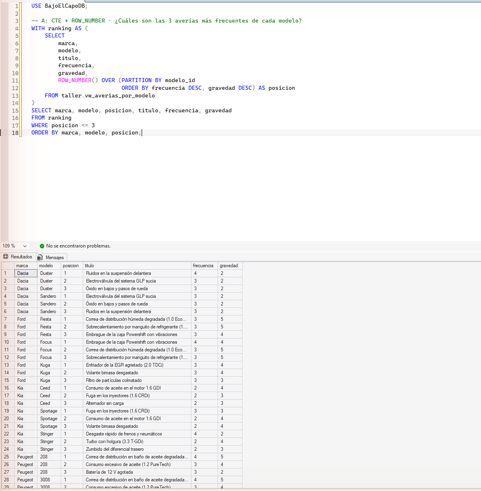

**Window functions: precio de cada coche frente a la media de su segmento** (194 filas; primeras 5):

```text
segmento marca modelo matricula precio_venta media_segmento diferencia puesto_mas_barato
Berlina Volkswagen Passat 8465YXK 5050.00 13205.00 -8155.00 1
Berlina Volkswagen Passat 2104ZNX 7050.00 13205.00 -6155.00 2
Berlina Volkswagen Passat 0344LKF 11700.00 13205.00 -1505.00 3
Berlina Volkswagen Passat 6724VMN 11800.00 13205.00 -1405.00 4
Berlina Volkswagen Passat 1590KVH 13800.00 13205.00 595.00 5
```

**Consulta correlacionada: modelos que cuestan más de mantener que la media de su marca** (12 filas;
primeras 9):

```text
marca modelo coste_esperado
Dacia Duster 2456.00
Dacia Sandero 2340.00
Ford Focus 4236.00
Ford Fiesta 3930.00
Kia Sportage 2460.00
Kia Stinger 2280.00
Peugeot 308 SW 5056.00
Peugeot 3008 4716.00
Renault Scénic 4170.00
```

**JSON (`OPENJSON`): coches disponibles con isofix** (94 filas; primeras 5):

```text
marca modelo matricula precio_venta
Renault Clio 3699XWM 3500.00
Renault Clio 3709PDS 3500.00
Ford Fiesta 5398MXK 3500.00
Ford Focus 6854RCH 3500.00
Ford Focus 2956FSW 3500.00
```

**JSON (`JSON_OBJECT` + `JSON_ARRAYAGG`): ficha de un coche lista para una aplicación** (inicio):

```text
{"matricula":"6970WZV","marca":"Seat","modelo":"Ibiza","anio":2022,"km":69300,"precio":8650.00,
 "extras":["techo panorámico","isofix","enganche de remolque","faros LED","control de crucero","portón eléctrico"],
 "averias_top":["Embrague de la caja DSG7 con tirones", ...]}
```

**Expresiones regulares (`REGEXP_REPLACE` + `REGEXP_LIKE`): teléfonos normalizados** (24 filas;
selección):

```text
nombre telefono telefono_normalizado validacion
Alba Fuentes 686-464-289 686464289 Válido
Cristina Pascual 792 602 932 792602932 Válido
Paula Serrano 664-088-621 664088621 Válido
Adrián Calvo 91 207 33 74 912073374 Revisar
Beatriz Méndez (+34) 617294256 34617294256 Revisar
Diego Romero +34 746 443 329 34746443329 Revisar
```

### 9.2 Reservas y ventas (bloque A)

Los tests comprueban el flujo completo:

- Se reserva un coche y el trigger lo marca como `Reservado`.
- Un segundo intento de reservarlo falla con el error **50102** («El vehículo no está
  disponible»).
- Se cierra la venta y el trigger lo marca como `Vendido`.
- Al final, todo se limpia.

```text
OK F2: doble reserva rechazada con el error 50102
OK F: reserva, doble reserva, venta y limpieza correctas
```

### 9.3 Seguridad (bloque C)

Salida real de `tests/demo_seguridad.sql`, que ejecuta las mismas consultas con distintos usuarios
mediante `EXECUTE AS USER`:

```text
--- A: RLS · misma consulta con distintos usuarios ---
usuario reservas_visibles clientes_visibles
admin_demo 44 24
comercial_ana 7 6
comercial_luis 8 6
comercial_marta 15 6
comercial_javier 14 6
--- C: DDM · administrador (sin máscara) frente a comercial (enmascarado) ---
usuario nombre email telefono
admin_demo Lucía Ferrer lucia.ferrer@example.com 685 476 677
admin_demo Carmen Vidal carmen.vidal@example.org (+34) 730304941
admin_demo Paula Serrano paula.serrano@example.net 664-088-621
comercial_ana Lucía Ferrer lXXX@XXXX.com XXX-XXX-677
comercial_ana Carmen Vidal cXXX@XXXX.com XXX-XXX-941
comercial_ana Paula Serrano pXXX@XXXX.com XXX-XXX-621
--- D: mecánico · averías sí, clientes y reservas no ---
mecanico_demo Peugeot 208 Correa de distribución en baño de aceite degradada (1.2 PureTech) 20
mecanico_demo -> ventas.Clientes: DENEGADO (error 229): Se denegó el permiso SELECT en el objeto 'Clientes', base de datos 'BajoElCapoDB', esquema 'ventas'.
mecanico_demo -> ventas.vw_reservas: DENEGADO (error 229): Se denegó el permiso SELECT en el objeto 'vw_reservas', base de datos 'BajoElCapoDB', esquema 'ventas'.
--- E: comercial · precio de compra no accesible ---
comercial_ana -> catalogo.Vehiculos.precio_compra: DENEGADO (error 229): Se denegó el permiso SELECT en el objeto 'Vehiculos', base de datos 'BajoElCapoDB', esquema 'catalogo'.
--- F: servicio de IA · sin acceso a clientes ---
ia_servicio -> ventas.Clientes: DENEGADO (error 229): Se denegó el permiso SELECT en el objeto 'Clientes', base de datos 'BajoElCapoDB', esquema 'ventas'.
--- G: reserva con RLS activo (se deshace al final) ---
comercial_ana -> reserva para cliente de comercial_luis: RECHAZADA (error 50103): El cliente no existe.
usuario reserva_id estado marca modelo cliente
comercial_ana 47 Activa Seat Ibiza Lucía Ferrer
Reserva de demostración deshecha (ROLLBACK).
```

Cómo se lee:

- **RLS.** La misma consulta devuelve 44 reservas al administrador y entre 7 y 15 a cada
  comercial.
- **Máscaras.** El comercial ve el email y el teléfono enmascarados; el administrador, completos.
- **Mínimo privilegio.** El mecánico y el servicio de IA reciben un permiso denegado al consultar
  clientes, y el comercial no puede leer el precio de compra.
- **RLS en los procedimientos.** El comercial puede reservar para su cliente, pero no para el de
  otro comercial: para él, ese cliente «no existe».

Para repetirlo:

```powershell
sqlcmd -S localhost -d BajoElCapoDB -E -C -I -f 65001 -i tests\demo_seguridad.sql
```

*SSMS · RLS: reservas y clientes visibles por usuario*

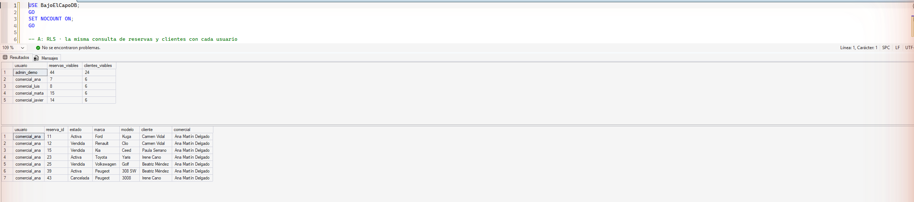

*SSMS · Dynamic Data Masking: administrador frente a comercial*

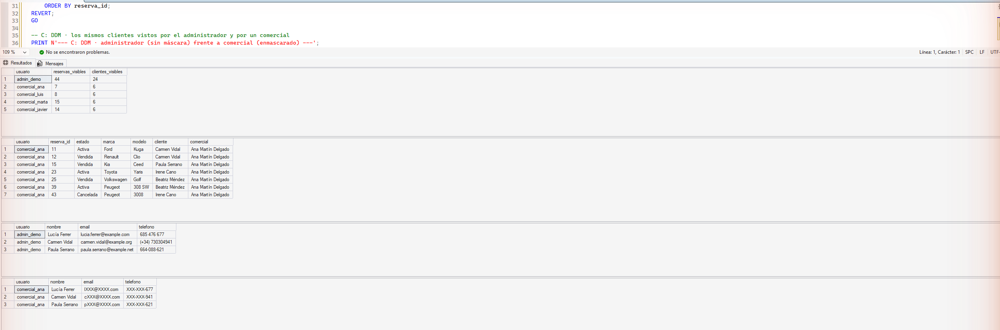

*SSMS · pestaña Mensajes con los permisos denegados (error 229)*

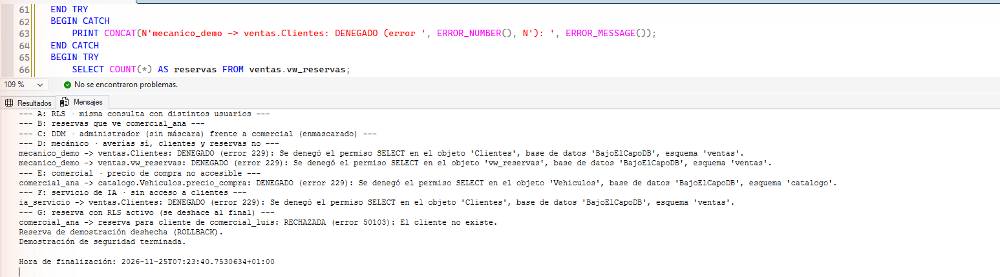

### 9.4 Optimización (bloque D)

**La consulta.** Primera página del listado del catálogo: 50 SUV disponibles entre 10.000 y
15.000 €, ordenados por precio, con su marca y modelo. Para que el plan cambie de verdad, se mide
con **50.228 coches** (50.000 de carga temporal más los 228 de prueba).

```sql
SELECT TOP (50) v.matricula, ma.nombre AS marca, mo.nombre AS modelo, v.anio, v.kilometros, v.precio_venta
FROM catalogo.Vehiculos AS v
JOIN catalogo.Modelos   AS mo ON mo.modelo_id = v.modelo_id
JOIN catalogo.Marcas    AS ma ON ma.marca_id  = mo.marca_id
WHERE v.estado = N'Disponible' AND mo.segmento = N'SUV' AND v.precio_venta BETWEEN 10000 AND 15000
ORDER BY v.precio_venta;
```

**La mejora.** Un índice compuesto:

```sql
CREATE INDEX ix_vehiculos_estado_precio
    ON catalogo.Vehiculos (estado, precio_venta)
    INCLUDE (modelo_id, matricula, anio, kilometros);
```

**STATISTICS IO y TIME** (segunda ejecución de cada consulta, con la caché en el mismo estado):

```text
ANTES
Tabla "Vehiculos". Número de examen 1, lecturas lógicas 2974
Tabla "Marcas". Número de examen 0, lecturas lógicas 12
Tabla "Modelos". Número de examen 1, lecturas lógicas 2
Tiempo de CPU = 16 ms, tiempo transcurrido = 11 ms

DESPUÉS
Tabla "Marcas". Número de examen 0, lecturas lógicas 100
Tabla "Modelos". Número de examen 0, lecturas lógicas 418
Tabla "Vehiculos". Número de examen 1, lecturas lógicas 5
Tiempo de CPU = 0 ms, tiempo transcurrido = 1 ms
```

**Resumen extraído de los planes de ejecución reales:**

```text
ANTES · coste estimado del plan (StatementSubTreeCost): 2.41887
ANTES · acceso a Vehiculos: Clustered Index Scan sobre [pk_vehiculos] · filas leídas: 50228 · coste del operador: 2.25113
DESPUÉS · coste estimado del plan (StatementSubTreeCost): 0.0518114
DESPUÉS · acceso a Vehiculos: Index Seek sobre [ix_vehiculos_estado_precio] · filas leídas: 209 · coste del operador: 0.0045817
```

| Métrica | Antes | Después |
| --- | --- | --- |
| Acceso a `Vehiculos` | Clustered Index Scan | **Index Seek** |
| Otros operadores | Hash Match + Sort (TopN Sort) | Nested Loops + Top |
| Filas leídas en `Vehiculos` | 50.228 | **209** |
| Coste estimado del plan | 2,41887 | **0,0518114** |
| Lecturas lógicas `Vehiculos` | 2.974 | **5** |
| Lecturas lógicas totales | 2.988 | **523** |
| Tiempo de CPU / transcurrido | 16 ms / 11 ms | 0 ms / 1 ms |

**Por qué mejora.**

- **Antes**, ningún índice empieza por `estado` ni por `precio_venta`. SQL Server lee la tabla
  entera (50.228 filas anchas, con descripción, JSON y vector), la cruza con los modelos y la ordena
  para quedarse con 50.
- **Después**, el índice tiene `estado` como primera clave (comparación de igualdad) y
  `precio_venta` como segunda (rango y orden). El *Seek* salta directamente a «Disponible,
  10.000 €» y lee ya ordenado por precio. Por eso desaparece el *Sort*, y el *Top* se detiene en
  cuanto reúne 50 SUV: solo ha leído 209 filas. Las columnas `INCLUDE` cubren la consulta, así que
  no hace falta volver a la tabla.

**Lo que empeora.** El plan pasa a un bucle anidado: por cada coche busca su modelo y por cada SUV
su marca. Por eso las lecturas de `Modelos` (2 → 418) y `Marcas` (12 → 100) suben. Son páginas
pequeñas y ya en memoria, y el total baja un **82 %** (2.988 → 523). Si se pidiera un rango de
precios enorme sin `TOP`, el bucle anidado perdería ventaja frente al recorrido completo.

Al terminar, `07` borra los 50.000 coches de carga y conserva el índice. Los planes gráficos se
abren en SSMS desde `docs/evidencias/003-plan-antes.sqlplan` y `003-plan-despues.sqlplan`.

*SSMS · plan ANTES: Clustered Index Scan + Hash Match + Sort*

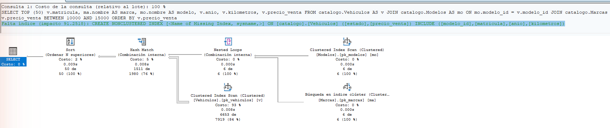

*SSMS · plan DESPUÉS: Index Seek + Nested Loops + Top*

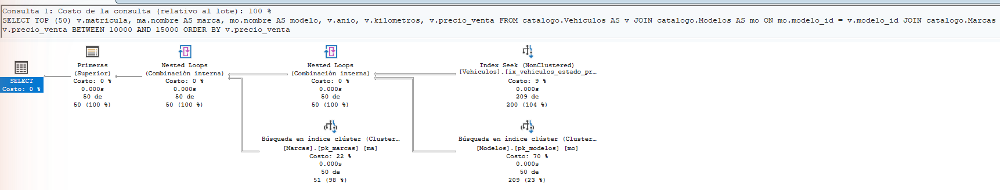

### 9.5 Búsqueda semántica (bloques E y F)

Tres frases, por las dos vías. Para cada una, un script compara automáticamente la posición, la
marca, el modelo, el precio y la distancia entre las dos vías.

**Frase 1: «familiar, económico y fiable para ciudad y escapadas»** (precio máximo 14.000 €)

Vía SSMS: `EXEC ia.sp_buscar_coches @consulta = N'familiar, económico y fiable para ciudad y escapadas', @precio_max = 14000, @top = 5;`

```text
posicion distancia marca modelo segmento anio kilometros combustible precio_venta descripcion
1 .4500 Peugeot 308 SW Familiar 2020 89100 Diésel 8500.00 Pensado para cargar de todo: bicicletas, equipaje y sillas infantiles sin renunciar al confort...
2 .4569 Toyota Corolla Touring Sports Familiar 2020 103800 Híbrido 10150.00 Maletero enorme y plazas traseras amplias; caben carritos, maletas y la compra de la semana...
3 .4666 Seat León Compacto 2018 129000 Diésel 5750.00 Tamaño justo para cinco personas, con maletero práctico y conducción agradable...
4 .4679 Peugeot 308 SW Familiar 2018 125000 Gasolina 6000.00 Pensado para cargar de todo: bicicletas, equipaje y sillas infantiles...
5 .4679 Peugeot 308 SW Familiar 2016 141000 Gasolina 4350.00 Pensado para cargar de todo: bicicletas, equipaje y sillas infantiles...
```

Vía terminal: `.\ai\buscar_coches.ps1 -Consulta "familiar, económico y fiable para ciudad y escapadas" -PrecioMax 14000`

```text
Consulta: familiar, económico y fiable para ciudad y escapadas
Filtros: precio máximo 14000 · top 5

posicion distancia marca   modelo                 segmento anio precio_venta descripcion
-------- --------- -----   ------                 -------- ---- ------------ -----------
       1    0,4500 Peugeot 308 SW                 Familiar 2020      8500,00 Pensado para cargar de todo: bicicletas, equipaje y sillas infantiles …
       2    0,4569 Toyota  Corolla Touring Sports Familiar 2020     10150,00 Maletero enorme y plazas traseras amplias; caben carritos, maletas y l…
       3    0,4666 Seat    León                   Compacto 2018      5750,00 Tamaño justo para cinco personas, con maletero práctico y conducción a…
       4    0,4679 Peugeot 308 SW                 Familiar 2018      6000,00 Pensado para cargar de todo: bicicletas, equipaje y sillas infantiles …
       5    0,4679 Peugeot 308 SW                 Familiar 2016      4350,00 Pensado para cargar de todo: bicicletas, equipaje y sillas infantiles …

--- Comparación automática (posición, marca, modelo, precio y distancia): MISMO TOP en las dos vías
```

*SSMS · buscador (EXEC ia.sp_buscar_coches), frase 1*

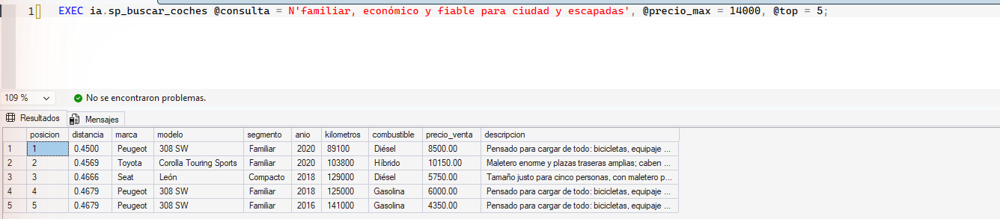

**Frase 2: «coche cómodo para viajes largos por autopista»**

```text
posicion distancia marca modelo segmento anio kilometros combustible precio_venta descripcion
1 .3983 Seat León Compacto 2018 115800 Gasolina 5800.00 Un coche polivalente para ir al trabajo entre semana y viajar el fin de semana...
2 .4021 Seat León Compacto 2018 129000 Diésel 5750.00 Tamaño justo para cinco personas... Diésel con mucho par, cómodo en viajes largos...
3 .4084 Seat Ateca SUV 2025 15600 Diésel 22850.00 Robusto y práctico para rutas por montaña o casas de campo...
4 .4086 Volkswagen Passat Berlina 2023 52900 Diésel 19300.00 Gran rodadora: estable en autopista, con un interior espacioso y bien acabado...
5 .4087 Seat León Compacto 2018 118300 Diésel 5800.00 Un coche polivalente para ir al trabajo entre semana y viajar el fin de semana...
--- Comparación automática (posición, marca, modelo, precio y distancia): MISMO TOP en las dos vías
```

**Frase 3: «aventura por caminos de tierra y fines de semana en el campo»** (segmento SUV)

```text
posicion distancia marca modelo segmento anio kilometros combustible precio_venta descripcion
1 .5897 Seat Ateca SUV 2025 15600 Diésel 22850.00 Robusto y práctico para rutas por montaña o casas de campo...
2 .5919 Seat Ateca SUV 2026 1000 Diésel 26950.00 Robusto y práctico para rutas por montaña o casas de campo...
3 .5961 Dacia Duster SUV 2023 43000 Diésel 10350.00 Robusto y práctico para rutas por montaña o casas de campo...
4 .5969 Seat Ateca SUV 2026 500 Gasolina 27000.00 Robusto y práctico para rutas por montaña o casas de campo...
5 .6022 Ford Kuga SUV 2015 159600 Diésel 4150.00 Espacioso y con aspecto aventurero, apto para viajes largos con toda la familia...
--- Comparación automática (posición, marca, modelo, precio y distancia): MISMO TOP en las dos vías
```

**Contraste con la búsqueda por palabras clave.** En todo el catálogo, ninguna descripción contiene
«familiar», «escapada», «económico» ni «fiable». Una búsqueda clásica por palabras no encontraría
nada para la frase 1. La búsqueda semántica sí devuelve coches con sentido, y ninguno de los cinco
contiene esas palabras:

```text
coches_con_palabra_familiar
0

posicion marca modelo contiene_palabras_de_la_frase
1 Peugeot 308 SW no
2 Toyota Corolla Touring Sports no
3 Peugeot 308 SW no
4 Peugeot 308 SW no
5 Seat León no
```

### 9.6 RAG: asesor de averías (bloque G)

En los tres casos:

- la vía SSMS devuelve **4 conjuntos de resultados** (pregunta, documentos, contexto y respuesta);
- una comparación automática confirma que el prompt de sistema y el contexto enviados son
  **idénticos en las dos vías**.

Prompt de sistema (el mismo en todos los casos):

```text
Eres el asesor de averías del concesionario Bajo el Capó. Responde solo con el contexto
proporcionado. Si no hay datos suficientes, dilo. Cita únicamente averías y costes que aparezcan en
el contexto; no inventes averías, causas ni precios. Si la sección de averías dice (ninguna),
responde que no hay averías registradas para ese modelo. Responde en español, en un máximo de cinco
frases.
```

**Pregunta 1: modelo con averías**

```text
=== 1. Pregunta ===
¿Qué averías suele tener y cuánto cuesta repararlas? (modelo: Peugeot 308 SW)

=== 2. Documentos recuperados ===
avería 1 · distancia 0.5599 · Avería: Amortiguadores traseros gastados. ... Coste estimado: 380 €. Frecuencia 2/5, gravedad 2/5, riesgo 4/25.
avería 2 · distancia 0.5804 · Avería: Depósito de AdBlue averiado. ... Coste estimado: 900 €. Frecuencia 3/5, gravedad 4/5, riesgo 12/25.
avería 3 · distancia 0.5848 · Avería: Consumo excesivo de aceite (1.2 PureTech). ... Coste estimado: 2500 €. Frecuencia 3/5, gravedad 4/5, riesgo 12/25.
avería 4 · distancia 0.5890 · Avería: Volante bimasa desgastado. ... Coste estimado: 1200 €. Frecuencia 3/5, gravedad 4/5, riesgo 12/25.
avería 5 · distancia 0.5988 · Avería: Correa de distribución en baño de aceite degradada (1.2 PureTech). ... Coste estimado: 1800 €. Frecuencia 4/5, gravedad 5/5, riesgo 20/25.
coche 1 · distancia 0.6420 · Coche disponible: Peugeot 308 SW de 2020, 89100 km, Diésel, 8500 €.
coche 2 · distancia 0.6513 · Coche disponible: Peugeot 308 SW de 2015, 174900 km, Diésel, 3600 €.
coche 3 · distancia 0.6592 · Coche disponible: Peugeot 308 SW de 2021, 80900 km, Diésel, 9950 €.

=== 3. Contexto enviado al modelo ===
AVERÍAS REGISTRADAS EN BAJO EL CAPÓ PARA Peugeot 308 SW:
- Avería: Amortiguadores traseros gastados. Síntoma: El coche rebota en las curvas y se oye ruido en la parte trasera. Solución: Sustituir los amortiguadores traseros por parejas. Coste estimado: 380 €. Frecuencia 2/5, gravedad 2/5, riesgo 4/25.
- (… las otras cuatro averías, con el mismo formato …)

COCHES DISPONIBLES RELACIONADOS:
- Coche disponible: Peugeot 308 SW de 2020, 89100 km, Diésel, 8500 €.
- Coche disponible: Peugeot 308 SW de 2015, 174900 km, Diésel, 3600 €.
- Coche disponible: Peugeot 308 SW de 2021, 80900 km, Diésel, 9950 €.

Pregunta: ¿Qué averías suele tener y cuánto cuesta repararlas?

=== 4. Respuesta ===
El Peugeot 308 SW suele tener averías como amortiguadores traseros gastados, depósito de AdBlue
averiado, consumo excesivo de aceite, volante bimasa desgastado e una correa de distribución en el
baño de aceite degradada. Las averías más costosas son la correa de distribución, con un costo
estimado de 1800 €, y el depósito de AdBlue, con un costo estimado de 900 €.
```

*SSMS · asesor (EXEC ia.sp_asesor_averias), Peugeot 308 SW: los cuatro conjuntos de resultados*

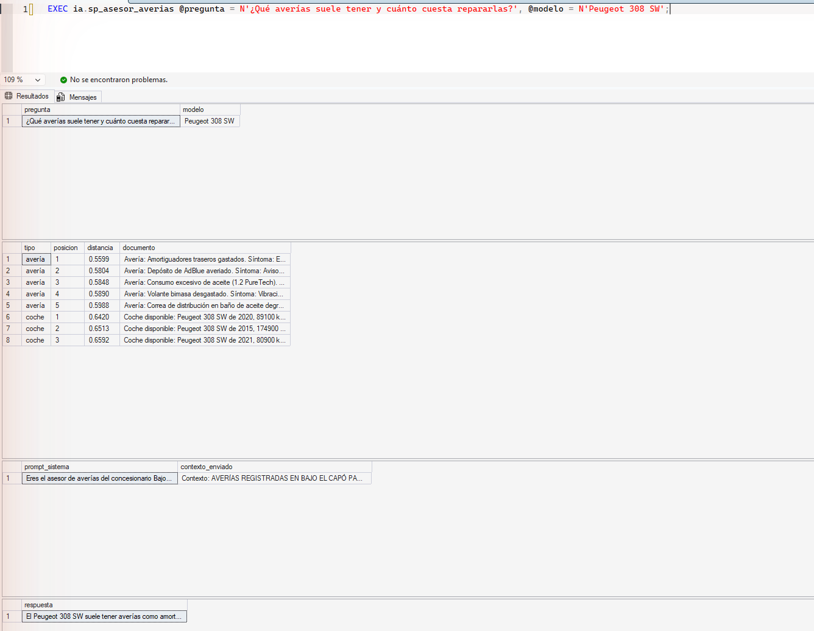

**Pregunta 2: síntoma, sin indicar modelo**

```text
=== 1. Pregunta ===
Al acelerar noto tirones y el embrague patina, ¿qué puede ser y cuánto cuesta arreglarlo? (sin modelo)

=== 2. Documentos recuperados ===
avería 1 · distancia 0.3604 · Avería: Embrague de la caja Powershift con vibraciones. ... Coste estimado: 1600 €. Modelos afectados: Ford Fiesta, Ford Focus, Ford Kuga.
avería 2 · distancia 0.3769 · Avería: Embrague de la caja DSG7 con tirones. ... Coste estimado: 1800 €. Modelos afectados: Seat Ibiza, Seat León, Seat Ateca, Volkswagen Polo, Volkswagen Golf.
avería 3 · distancia 0.4185 · Avería: Cojinetes de biela desgastados (1.5 dCi). ... Coste estimado: 2800 €.
avería 4 · distancia 0.4329 · Avería: Inyector de gasolina obstruido (1.0 TCe). ... Coste estimado: 400 €.
avería 5 · distancia 0.4357 · Avería: Bobina de encendido defectuosa. ... Coste estimado: 180 €.
coche 1 · distancia 0.5982 · Coche disponible: Kia Stinger de 2018, 125000 km, Diésel, 11800 €.
coche 2 · distancia 0.5987 · Coche disponible: Kia Stinger de 2023, 43100 km, Gasolina, 27400 €.
coche 3 · distancia 0.5994 · Coche disponible: Dacia Jogger de 2025, 20400 km, GLP, 16450 €.

=== 4. Respuesta ===
Avería: Embrague de la caja DSG7 con tirones. Coste estimado: 1800 €. Modelos afectados: Seat Ibiza,
Seat León, Seat Ateca, Volkswagen Polo, Volkswagen Golf.
```

*SSMS · asesor, pregunta por síntoma sin modelo*

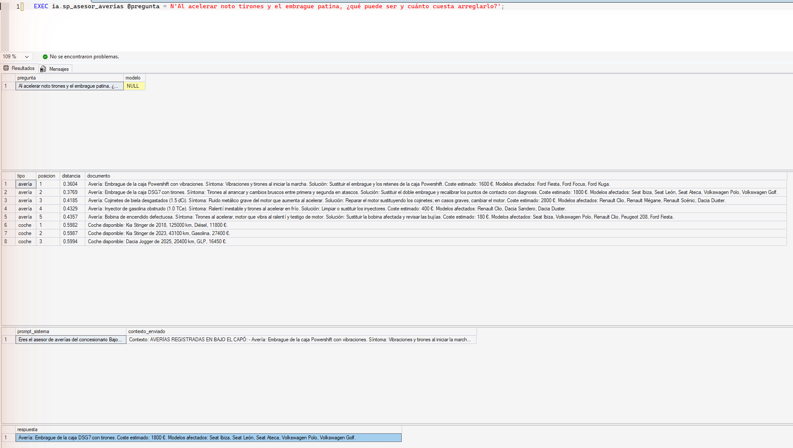

**Caso de control: Dacia Jogger, sin averías registradas**

```text
=== 1. Pregunta ===
¿Qué averías suele tener y cuánto cuesta repararlas? (modelo: Dacia Jogger)

=== 2. Documentos recuperados ===
coche 1 · distancia 0.6458 · Coche disponible: Dacia Jogger de 2025, 20400 km, GLP, 16450 €.
coche 2 · distancia 0.6506 · Coche disponible: Dacia Jogger de 2026, 19400 km, GLP, 19100 €.
coche 3 · distancia 0.6681 · Coche disponible: Dacia Jogger de 2022, 63500 km, GLP, 10000 €.

=== 3. Contexto enviado al modelo ===
AVERÍAS REGISTRADAS EN BAJO EL CAPÓ PARA Dacia Jogger:
(ninguna)

COCHES DISPONIBLES RELACIONADOS:
- Coche disponible: Dacia Jogger de 2025, 20400 km, GLP, 16450 €.
- Coche disponible: Dacia Jogger de 2026, 19400 km, GLP, 19100 €.
- Coche disponible: Dacia Jogger de 2022, 63500 km, GLP, 10000 €.

Pregunta: ¿Qué averías suele tener y cuánto cuesta repararlas?

=== 4. Respuesta ===
No hay averías registradas para ese modelo.
```

*SSMS · caso de control: Dacia Jogger*

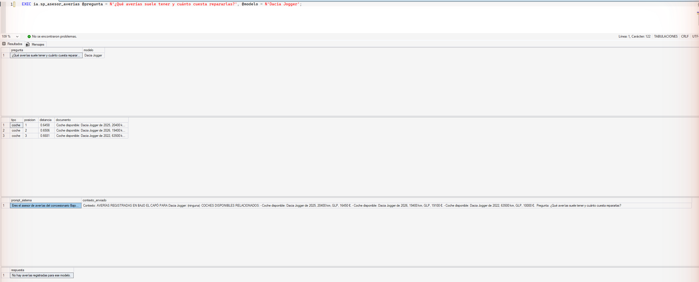

Cómo se leen los resultados:

- Las respuestas solo mencionan averías y costes que aparecen en el contexto.
- En el caso de control, el modelo **no inventa** averías: dice que no hay datos. Esa es la
  diferencia práctica entre un LLM solo y un RAG.
- Límites observados con un modelo pequeño (3B): algún error gramatical («e una») y, en la
  pregunta 2, cita solo una de las averías recuperadas. No inventa datos en ningún caso.

---

## 10. Estrategia de pruebas

Cada prueba lanza `THROW` con un código 500xx si falla, y `run_all.ps1` se detiene en el primer
error. Si el comando termina con `RESULTADO: todos los scripts y tests terminaron sin errores.`,
han pasado todas.

| Tipo de prueba | Qué comprueba | Bloque |
| --- | --- | --- |
| Estructurales | Existen las 9 tablas, cada una en su esquema, y no hay objetos en `dbo` | `tests.sql` A, B |
| De datos | Recuentos exactos (8, 24, 228, 57, 207, 4, 24, 44, 16) y coherencia entre coches, reservas y ventas | `tests.sql` C, D |
| De objetos | Vistas y funciones devuelven filas; el catálogo no expone `precio_compra`; el Jogger no tiene averías | `tests.sql` E |
| De integración | Flujo reserva → venta con el trigger, y limpieza | `tests.sql` F |
| Negativas | Doble reserva (50102); precio inválido (50113); permiso denegado (229); reserva para un cliente ajeno (50103); caso de control del RAG | `tests.sql` F, G; `tests_ia.sql` K |
| De seguridad | Roles, usuarios sin login, política RLS activa, columnas enmascaradas, filas distintas por comercial | `tests.sql` G |
| De rendimiento | El índice existe y la carga temporal se ha borrado (228 coches) | `tests.sql` H |
| De IA | Ningún vector vacío, 1024 dimensiones, ranking con filtros y orden, uso por un comercial; RAG limitado al modelo, uso por un mecánico, caso de control | `tests_ia.sql` I, J, K |
| De equivalencia | Mismo top y mismo contexto por SSMS y por terminal | Comparación automática ([sección 9.5](#95-búsqueda-semántica-bloques-e-y-f) y [9.6](#96-rag-asesor-de-averías-bloque-g)) |

Criterio del caso de control: la respuesta del Jogger **no cita ningún título de avería** de la base
de datos y expresa que no hay datos.

**Salida real completa de los tests** (`.\run_all.ps1 -ConIA`):

```text
=== tests\tests.sql
OK A: las 9 tablas existen y no hay objetos en dbo
OK B: tablas por esquema correctas
OK C: los 9 recuentos coinciden con 03_insert_data.sql
OK D: coches, reservas y ventas coherentes
OK E: vistas y funciones devuelven filas; el Dacia Jogger no tiene averías
OK F2: doble reserva rechazada con el error 50102
OK F: reserva, doble reserva, venta y limpieza correctas
OK G: roles, RLS, DDM y permisos denegados correctos
OK H: índice de optimización creado y 228 coches tras borrar la carga
TESTS: todos los bloques han pasado.
--- OK tests\tests.sql (0.7 s)
=== tests\tests_ia.sql
OK I: 228 coches y 57 averías con embedding de 1024 dimensiones
OK J: buscador con top, filtros, orden por distancia y uso por un comercial
Respuesta del caso de control: No hay averías registradas para ese modelo.
OK K: RAG con recuperación por modelo, uso por un mecánico y caso de control sin inventar
--- OK tests\tests_ia.sql (1.5 s)
RESULTADO: todos los scripts y tests terminaron sin errores.
```

*SSMS · tests/tests.sql y tests/tests_ia.sql, pestaña Mensajes*

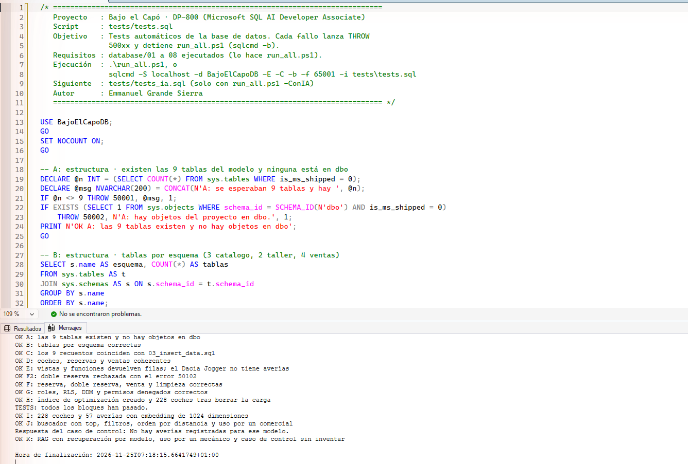

---

## 11. Solución de problemas

| Síntoma | Causa | Solución |
| --- | --- | --- |
| `...la ejecución de scripts está deshabilitada en este sistema` | Política de ejecución de PowerShell | `Set-ExecutionPolicy -Scope Process -ExecutionPolicy Bypass` (solo para esa consola) |
| `02` falla con el error 1934 (`QUOTED_IDENTIFIER`) | `sqlcmd` desactiva `QUOTED_IDENTIFIER` por defecto y el índice filtrado lo necesita | Usar `sqlcmd -I` (ya incluido en `run_all.ps1`) |
| Acentos rotos («económico») en las frases | Windows PowerShell 5.1 lee como ANSI los `.ps1` guardados sin BOM | Los `.ps1` del repositorio están en UTF-8 con BOM; si editas uno, guárdalo como «UTF-8 with BOM» |
| La vía SSMS falla con un error de certificado o de conexión (`50301`, `50304`) | Caddy no está arrancado o SQL Server no confía en su certificado | Arranca Caddy y confía en su certificado en el almacén del **equipo local** (paso 4) |
| `No se pudo llamar a Ollama en http://localhost:11434…` | Ollama no está en marcha | Ábrelo o ejecuta `ollama serve` |
| La primera respuesta tarda | Ollama carga el modelo en memoria | Es normal; las siguientes son rápidas |
| Error `50306`: «El modelo indicado no existe» | Nombre de modelo mal escrito | Escríbelo como en el catálogo: `"Peugeot 308 SW"`, `"308 SW"`, `"Dacia Jogger"` |
| `sp_invoke_external_rest_endpoint` desactivado | Viene desactivado en SQL Server 2025 | `ai/create_external_model.sql` lo activa con `sp_configure 'external rest endpoint enabled', 1` |

Errores propios de los procedimientos de IA:

| Código | Significado |
| --- | --- |
| 50301 | El modelo externo no devolvió un vector de 1024 dimensiones |
| 50302 | Falló la generación de embeddings |
| 50303 | La consulta o la pregunta está vacía |
| 50304 | No se pudo generar el embedding |
| 50305 | El vector recibido no es válido |
| 50306 | El modelo indicado no existe |
| 50307 / 50308 | Falló la llamada al modelo de chat, o no devolvió texto |

---

## 12. Conclusiones

### Qué se ha aprendido

- **SQL Server 2025 puede ser el centro de un sistema de IA.** Guarda los datos, aplica la
  seguridad, almacena los vectores y hace la recuperación del RAG sin servicios externos, con
  `VECTOR`, `VECTOR_DISTANCE`, `CREATE EXTERNAL MODEL`, `AI_GENERATE_EMBEDDINGS` y
  `sp_invoke_external_rest_endpoint`. El modelo local solo genera los vectores y redacta la
  respuesta.
- **La búsqueda semántica encuentra lo que la búsqueda por palabras no ve.** Ninguna descripción
  contiene «familiar» ni «escapadas», y aun así el primer resultado es un familiar «pensado para
  cargar de todo: bicicletas, equipaje y sillas infantiles».
- **Un RAG bien acotado no inventa.** Con un prompt restrictivo, temperatura 0 y un contexto
  marcado como «(ninguna)», incluso un modelo pequeño (3B) responde que no hay datos.
- **La seguridad también se aplica a la IA.** Con `EXECUTE AS`, comerciales y mecánicos usan el
  buscador y el asesor sin permisos sobre el modelo, y RLS y las máscaras siguen protegiendo los
  datos de clientes a través de vistas y procedimientos.
- **Medir explica mejor que el tiempo.** Con milisegundos en los dos casos, lo que demuestra la
  mejora es el plan real y las lecturas lógicas: 2.974 → 5 en `Vehiculos`.

### Qué problemas surgieron y cómo se resolvieron

| Problema | Solución |
| --- | --- |
| El índice filtrado de `02` fallaba al ejecutarlo con `sqlcmd` (error 1934) | `sqlcmd -I` para activar `QUOTED_IDENTIFIER` |
| SQL Server no puede llamar a Ollama por HTTP | Proxy HTTPS local con Caddy (`tls internal`) y confianza en su certificado en el almacén del equipo |
| La ficha JSON devolvía la lista de averías como texto escapado (`"[\"Embrague…`) | `CAST((subconsulta) AS JSON)` en lugar de `JSON_QUERY`, que no funcionaba con `ORDER BY` dentro de `JSON_ARRAYAGG` |
| El script de seguridad fallaba al repetirlo (error 16007) | Quitar las máscaras con SQL dinámico: `DROP MASKED` se valida al compilar |
| Una reserva de la demostración de seguridad se guardaba de verdad | El `ROLLBACK` del procedimiento deshacía la transacción externa; el intento que falla se movió fuera de la transacción |
| Acentos rotos al enviar frases desde PowerShell | Guardar los `.ps1` en UTF-8 con BOM y enviar a Ollama en UTF-8 explícito |
| `"stream": false` no se podía generar con `CAST('false' AS JSON)` | `JSON_MODIFY(..., '$.stream', CAST(0 AS BIT))` |

### Qué mejoras podrían implementarse

- Índice vectorial (DiskANN) y `VECTOR_SEARCH` cuando salgan de vista previa, para catálogos
  grandes.
- **Búsqueda híbrida**: combinar las palabras clave (texto completo) con los vectores.
- Fragmentar textos largos con `AI_GENERATE_CHUNKS` (manuales de taller, historiales).
- Una interfaz mínima para los comerciales.
- Pruebas con **tSQLt** o **SQL Database Projects**, ejecutadas en integración continua.
- Un modelo de chat mayor (por ejemplo qwen2.5:7b) en equipos con más memoria, para respuestas más
  completas.

---

## 13. Estructura del repositorio

```text
bajo-el-capo/
├── README.md
├── run_all.ps1                     ← recrea la base y ejecuta los tests (-ConIA para la IA)
├── img/                            ← capturas de cada demostración en SSMS
├── database/
│   ├── 01_create_database.sql      ← base de datos y esquemas
│   ├── 02_create_tables.sql        ← 9 tablas, claves, restricciones e índices
│   ├── 03_insert_data.sql          ← datos de prueba
│   ├── 04_views.sql                ← vistas
│   ├── 05_procedures.sql           ← funciones, procedimientos y trigger
│   ├── 06_security.sql             ← roles, permisos, RLS y DDM
│   ├── 07_indexes.sql              ← optimización (carga, medición, índice y limpieza)
│   └── 08_advanced_queries.sql     ← CTE, window functions, correlacionada, JSON y regex
├── ai/
│   ├── create_external_model.sql   ← modelo externo de embeddings (bge-m3)
│   ├── generate_embeddings.sql     ← vectores de coches y averías
│   ├── vector_search.sql           ← buscador semántico
│   ├── rag.sql                     ← asesor de averías (RAG)
│   ├── comun.ps1                   ← funciones compartidas de la vía terminal
│   ├── buscar_coches.ps1           ← buscador desde la terminal
│   └── asesor_averias.ps1          ← asesor desde la terminal
├── tests/
│   ├── tests.sql                   ← pruebas A a H
│   ├── tests_ia.sql                ← pruebas de IA I a K
│   ├── test_conexion_ia.sql        ← prueba de la cadena SQL Server → Caddy → Ollama
│   ├── demo_seguridad.sql          ← demostración con distintos usuarios
│   └── medir_optimizacion.ps1      ← planes reales antes y después
└── docs/
    ├── proyecto.md                 ← informe técnico (se exporta a PDF)
    ├── bloque-b.md                 ← desarrollo asistido por IA
    ├── decisiones.md               ← decisiones técnicas y su motivo
    └── evidencias/                 ← salidas completas de las ejecuciones
```
