# Bajo el Capó

## Buscador semántico y asesor de averías para un concesionario de coches de segunda mano

| | |
| --- | --- |
| **Autor** | Emmanuel Grande Sierra |
| **Certificación** | Microsoft DP-800 · SQL AI Developer Associate |
| **Práctica** | Práctica 09 · Mini-proyecto de BD vectoriales |
| **Nivel** | Nivel 3 (Avanzado) |
| **Fecha** | Octubre de 2026 |
| **Repositorio** | [ENLACE AL REPOSITORIO DE GITHUB] |

---

## 1. Portada

*Bajo el Capó* es una solución local con **SQL Server 2025** y **Ollama** que combina diseño de
bases de datos, seguridad, optimización e inteligencia artificial dentro de la propia base de
datos: embeddings, búsqueda vectorial y RAG.

Este informe explica qué se ha construido, por qué y con qué resultados. Todas las cifras y
salidas que aparecen proceden de ejecuciones reales. El código completo y las instrucciones para
reproducirlo están en el repositorio de GitHub (`README.md`).

---

## 2. Objetivo del proyecto

Diseñar, implementar, documentar y demostrar una base de datos SQL Server 2025 que cubra los
bloques A a G del enunciado y alcance el **nivel 3** (Nivel 2 + Vector Search + RAG + modelo
local).

Objetivos concretos:

1. Un modelo relacional con relaciones 1:N, N:M y 1:1, restricciones, índices, vistas,
   procedimientos, funciones y un trigger.
2. Seguridad con tres mecanismos: mínimo privilegio, Row-Level Security y Dynamic Data Masking.
3. Optimización de una consulta, medida con el plan de ejecución real y las lecturas lógicas.
4. Embeddings generados con un modelo local (bge-m3) y guardados en `VECTOR(1024)`.
5. Un buscador semántico con ranking por distancia coseno.
6. Un RAG con un modelo local (qwen2.5:3b) que responde solo con datos recuperados.
7. Dos vías de uso (SSMS y terminal) con la misma lógica de recuperación.
8. Todo reproducible desde cero con un comando: `.\run_all.ps1 -ConIA`.

---

## 3. Caso de uso

*Bajo el Capó* es un concesionario ficticio de coches de segunda mano con un problema doble:

- **El comprador** no sabe de mecánica. Ve anuncios muy parecidos y no sabe qué averías son
  típicas de cada modelo ni cuánto le costarán.
- **El concesionario** pierde ventas por falta de confianza, o vende coches que después generan
  reclamaciones.

**Ejemplo.** Marta busca un coche familiar por menos de 14.000 €. El comercial escribe lo que
Marta pide con sus propias palabras («familiar, económico y fiable para ciudad y escapadas») y
obtiene coches parecidos en significado. Después consulta al asesor qué averías suele tener el
modelo elegido y cuánto cuesta repararlas, con datos reales del taller y antes de firmar.

| Usuario | Qué necesita | Qué puede hacer en el sistema |
| --- | --- | --- |
| Comercial | Encontrar el coche que encaja y argumentar con datos | Catálogo (sin precio de compra), buscador, asesor, sus reservas y sus clientes |
| Mecánico | Conocer las averías de cada modelo | Modelos, averías y asesor; ningún dato comercial |
| Administrador | Control total | Todo, incluidos los datos sin máscara |
| Servicio de IA | Llamar a los modelos | Usar el modelo externo y leer el contexto; ni clientes ni escrituras |

---

## 4. Arquitectura

La solución tiene tres capas:

- el **usuario**, que trabaja desde SSMS o desde la terminal;
- **SQL Server**, que concentra los datos, la seguridad, los vectores y la recuperación;
- **Ollama**, que aporta los embeddings y las respuestas.

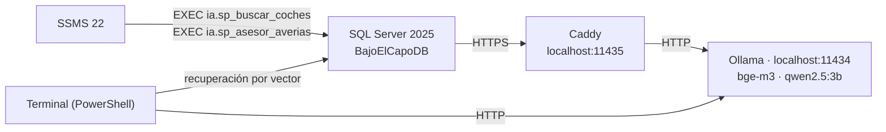

- **Vía SSMS.** Todo ocurre dentro de SQL Server: `AI_GENERATE_EMBEDDINGS` genera el vector,
  `VECTOR_DISTANCE` busca y `sp_invoke_external_rest_endpoint` llama al modelo de chat. SQL Server
  solo admite HTTPS para modelos externos, así que Caddy expone Ollama en
  `https://localhost:11435` con un certificado local.
- **Vía terminal.** `buscar_coches.ps1` y `asesor_averias.ps1` piden el embedding y la respuesta a
  Ollama directamente y usan SQL Server para la recuperación. El ranking y el contexto se calculan
  en T-SQL con las mismas funciones que la vía SSMS.

**Flujo del RAG:** pregunta → embedding (bge-m3) → búsqueda vectorial en SQL Server → averías y
coches recuperados → contexto → qwen2.5:3b → respuesta.

---

## 5. Modelo de datos

Base de datos `BajoElCapoDB`, con intercalación `Modern_Spanish_CI_AS` y nivel de compatibilidad
170. Tiene cinco esquemas (`catalogo`, `taller`, `ventas`, `ia` y `seg`) y ningún objeto en `dbo`.

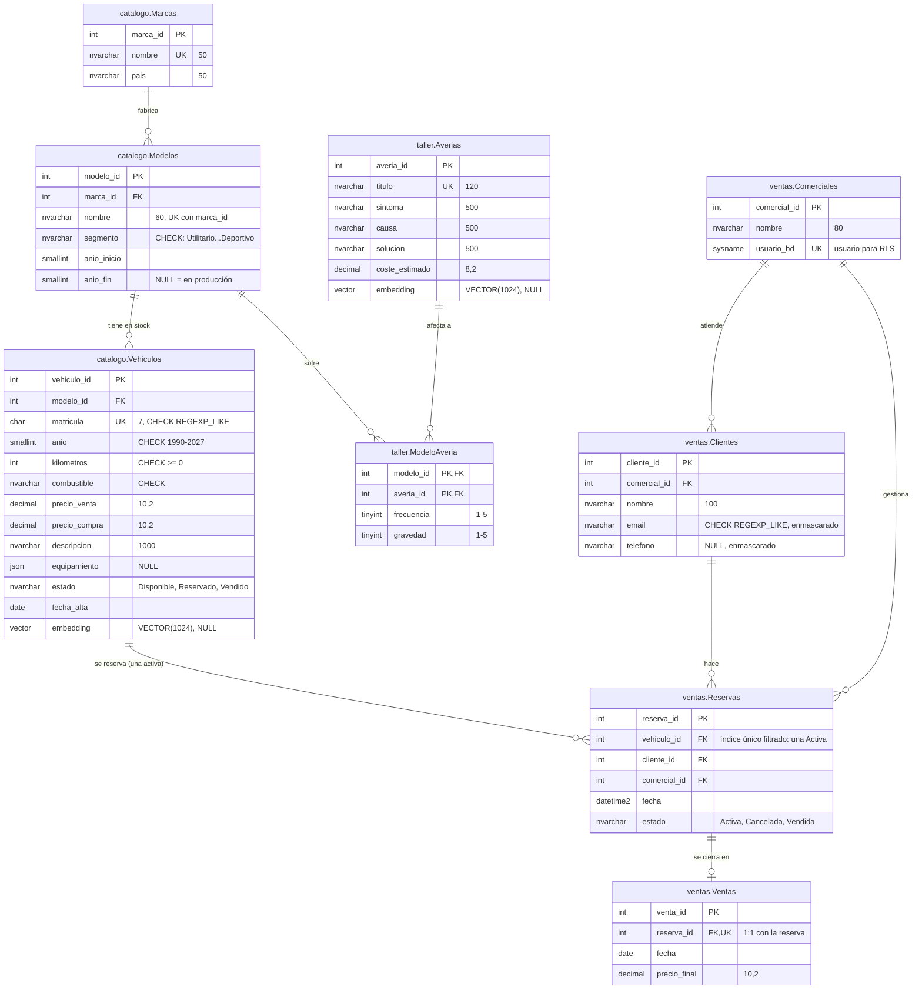

| Tabla | Filas | Descripción |
| --- | --- | --- |
| catalogo.Marcas | 8 | Marcas y país |
| catalogo.Modelos | 24 | Modelos con segmento y años de producción |
| catalogo.Vehiculos | 228 | Coches en stock: matrícula, precios, descripción, equipamiento (JSON), estado y embedding |
| taller.Averias | 57 | Averías conocidas: síntoma, causa, solución, coste y embedding |
| taller.ModeloAveria | 207 | Qué averías tiene cada modelo, con frecuencia y gravedad (1 a 5) |
| ventas.Comerciales | 4 | Comerciales y su usuario de base de datos (para RLS) |
| ventas.Clientes | 24 | Clientes, cada uno asignado a un comercial |
| ventas.Reservas | 44 | Reservas (Activa, Cancelada o Vendida) |
| ventas.Ventas | 16 | Ventas cerradas, una por reserva |

**Restricciones destacadas:**

- Matrícula y email validados con expresiones regulares (`REGEXP_LIKE`).
- CHECK en segmentos, estados, años, kilómetros, precios, frecuencia y gravedad.
- Un índice único filtrado impide dos reservas activas sobre el mismo coche.
- Los vectores se guardan en columnas `VECTOR(1024)`.

El **Dacia Jogger** no tiene averías registradas: es el caso de control del RAG.

*SSMS · filas por tabla*

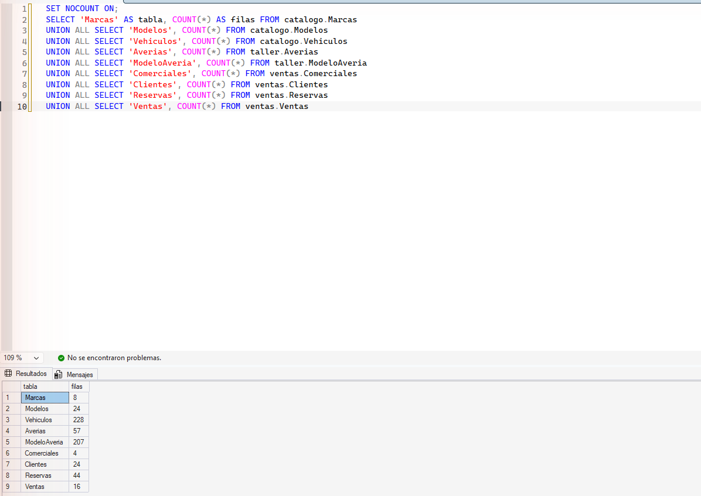

---

## 6. Funcionalidades implementadas

| Bloque | Implementación |
| --- | --- |
| A · Diseño y T-SQL | 9 tablas; 3 vistas (`vw_catalogo` no expone el precio de compra); funciones `fn_coste_esperado` y `fn_averias_modelo`; procedimientos `sp_registrar_reserva` y `sp_registrar_venta` con transacciones, bloqueo y errores controlados; trigger `tr_reservas_estado`; consultas con CTE, window functions, consulta correlacionada, JSON y expresiones regulares |
| B · Desarrollo asistido por IA | Asistente de IA (Claude, en el chat) usado principalmente para generar los datos de prueba y para la planificación general del proyecto. Documentado en `docs/bloque-b.md` |
| C · Seguridad | 4 roles, 7 usuarios sin inicio de sesión, `GRANT`/`DENY`, Row-Level Security y Dynamic Data Masking |
| D · Optimización | Índice compuesto para el listado del catálogo, medido con 50.228 coches |
| E · Embeddings | Modelo externo bge-m3; 228 coches y 57 averías en `VECTOR(1024)` |
| F · Intelligent Search | Ranking por distancia coseno con filtros, por dos vías |
| G · RAG | Asesor de averías con las cuatro partes visibles y caso de control, por dos vías |

### 6.1 Desarrollo asistido por IA (bloque B)

| Uso | Qué se pidió | Qué se aceptó y qué se corrigió | Cómo se verificó |
| --- | --- | --- | --- |
| Datos de prueba | Un script de inserción para las 9 tablas: un concesionario grande, descripciones naturales que no repitan las palabras de las búsquedas, equipamiento en JSON, teléfonos con formatos distintos y un modelo sin averías | Se aceptó el script completo (897 líneas). No hubo que cambiar los datos; sí la forma de ejecutarlo (`sqlcmd -I`) | Tests de recuentos exactos y de coherencia entre coches, reservas y ventas |
| Planificación general | Alcance por bloques, tecnologías, modelo de datos, orden de trabajo por fases y estrategia de pruebas | Se aceptó la división en seis fases y la estructura del repositorio. Se corrigió el planteamiento inicial: Ollama en lugar de Copilot Chat como IA de la solución, Caddy para el HTTPS, dos vías de uso, esquemas propios en lugar de `dbo` y una tabla `Ventas` para cerrar el ciclo reserva-venta | Cada fase se cerró con sus tests en verde y sus salidas reales |

### 6.2 Estrategia de pruebas

Cada prueba lanza `THROW` con un código 500xx si falla, y `run_all.ps1` se detiene en el primer
error.

| Tipo | Qué comprueba | Bloque de tests |
| --- | --- | --- |
| Estructurales | 9 tablas, reparto por esquema, nada en `dbo` | `tests.sql` A, B |
| De datos | Recuentos exactos y coherencia entre coches, reservas y ventas | `tests.sql` C, D |
| De objetos | Vistas y funciones devuelven filas; el catálogo no expone el precio de compra | `tests.sql` E |
| De integración | Reserva → venta con el trigger y limpieza | `tests.sql` F |
| Negativas | Doble reserva (50102), permiso denegado (229), cliente ajeno (50103), caso de control del RAG | `tests.sql` F, G; `tests_ia.sql` K |
| De seguridad | Roles, RLS activa, columnas enmascaradas | `tests.sql` G |
| De rendimiento | El índice existe y la carga temporal se ha borrado | `tests.sql` H |
| De IA | Vectores completos de 1024 dimensiones, ranking con filtros, RAG limitado al modelo | `tests_ia.sql` I, J, K |

Resultado real de la ejecución completa desde cero (`.\run_all.ps1 -ConIA`):

```text
OK A: las 9 tablas existen y no hay objetos en dbo
OK B: tablas por esquema correctas
OK C: los 9 recuentos coinciden con 03_insert_data.sql
OK D: coches, reservas y ventas coherentes
OK E: vistas y funciones devuelven filas; el Dacia Jogger no tiene averías
OK F2: doble reserva rechazada con el error 50102
OK F: reserva, doble reserva, venta y limpieza correctas
OK G: roles, RLS, DDM y permisos denegados correctos
OK H: índice de optimización creado y 228 coches tras borrar la carga
OK I: 228 coches y 57 averías con embedding de 1024 dimensiones
OK J: buscador con top, filtros, orden por distancia y uso por un comercial
OK K: RAG con recuperación por modelo, uso por un mecánico y caso de control sin inventar
RESULTADO: todos los scripts y tests terminaron sin errores.
```

*SSMS · tests/tests.sql y tests/tests_ia.sql, pestaña Mensajes*

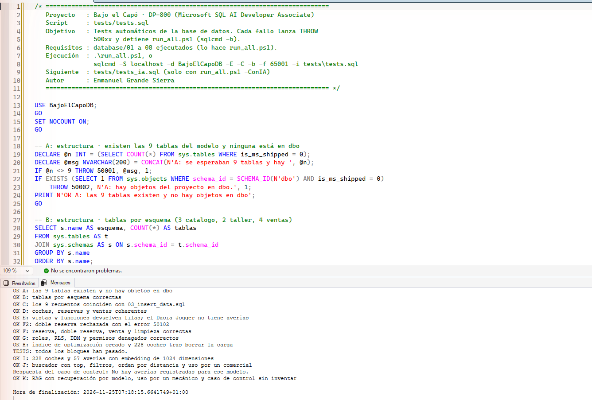

---

## 7. Consultas o código más importante

**Las 3 averías más frecuentes de cada modelo** (CTE + window function):

```sql
WITH ranking AS (
    SELECT marca, modelo, titulo, frecuencia,
           ROW_NUMBER() OVER (PARTITION BY modelo_id ORDER BY frecuencia DESC, gravedad DESC) AS posicion
    FROM taller.vw_averias_por_modelo)
SELECT marca, modelo, posicion, titulo FROM ranking WHERE posicion <= 3;
```

*SSMS · las 3 averías más frecuentes de cada modelo (database/08_advanced_queries.sql)*

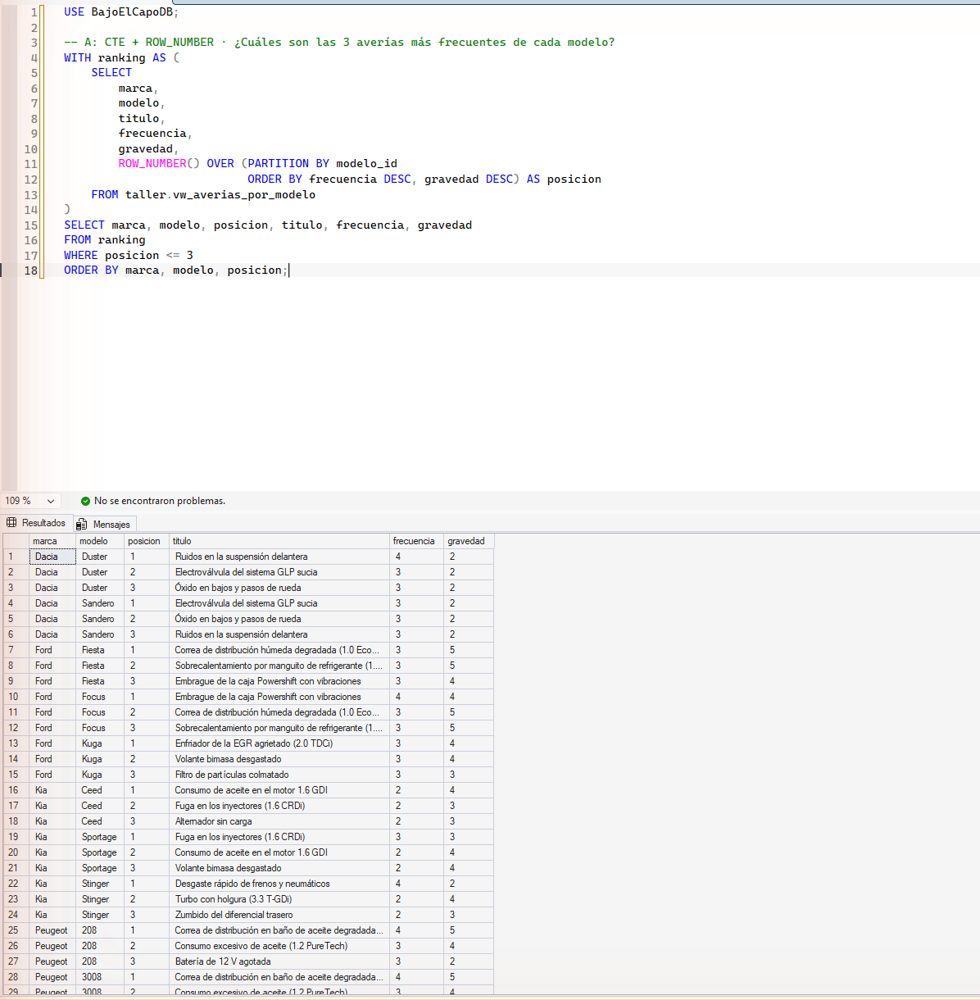

**Reserva sin conflictos.** `sp_registrar_reserva` bloquea el coche (`UPDLOCK, HOLDLOCK`) dentro de
la transacción. Si no está disponible, lanza el error 50102. El trigger `tr_reservas_estado`
recalcula el estado del coche a partir de todas sus reservas.

**Ranking semántico compartido por las dos vías** (`ia.fn_ranking_coches`):

```sql
SELECT TOP (@top) ..., VECTOR_DISTANCE('cosine', v.embedding, @vector) AS distancia
FROM catalogo.Vehiculos AS v ...
WHERE v.estado = N'Disponible'
  AND (@precio_max IS NULL OR v.precio_venta <= @precio_max)
  AND (@segmento IS NULL OR mo.segmento = @segmento)
ORDER BY distancia;
```

**IA sin permisos sobre el modelo.** `ia.sp_buscar_coches` e `ia.sp_asesor_averias` se declaran
`WITH EXECUTE AS 'ia_servicio'`. Comerciales y mecánicos solo tienen permiso `EXECUTE` sobre el
esquema `ia`.

---

## 8. Seguridad y optimización

### 8.1 Seguridad

| Mecanismo | Implementación |
| --- | --- |
| Mínimo privilegio | Un rol por perfil; acceso por vistas y procedimientos; `DENY` del esquema `ventas` al mecánico y al servicio de IA |
| Row-Level Security | Predicado `seg.fn_predicado_comercial`, que compara `USER_NAME()` con `usuario_bd`, con FILTER y BLOCK sobre clientes y reservas |
| Dynamic Data Masking | `email()` y `partial(0,"XXX-XXX-",3)`; `UNMASK` solo para el administrador |

Resultado real de la demostración (la misma consulta con distintos usuarios, mediante
`EXECUTE AS USER`):

```text
usuario reservas_visibles clientes_visibles
admin_demo 44 24
comercial_ana 7 6
comercial_luis 8 6
comercial_marta 15 6
comercial_javier 14 6

usuario nombre email telefono
admin_demo Lucía Ferrer lucia.ferrer@example.com 685 476 677
comercial_ana Lucía Ferrer lXXX@XXXX.com XXX-XXX-677

mecanico_demo -> ventas.Clientes: DENEGADO (error 229): Se denegó el permiso SELECT en el objeto 'Clientes' ...
comercial_ana -> catalogo.Vehiculos.precio_compra: DENEGADO (error 229): Se denegó el permiso SELECT en el objeto 'Vehiculos' ...
ia_servicio -> ventas.Clientes: DENEGADO (error 229): Se denegó el permiso SELECT en el objeto 'Clientes' ...
comercial_ana -> reserva para cliente de comercial_luis: RECHAZADA (error 50103): El cliente no existe.
```

Cada comercial ve solo sus reservas, los datos personales salen enmascarados para quien no es
administrador y los perfiles sin permiso reciben un error de acceso.

*SSMS · RLS: reservas y clientes visibles por usuario*

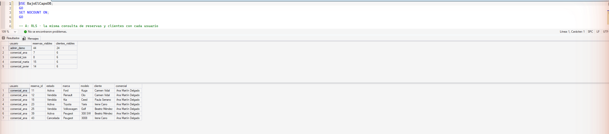

*SSMS · Dynamic Data Masking: administrador frente a comercial*

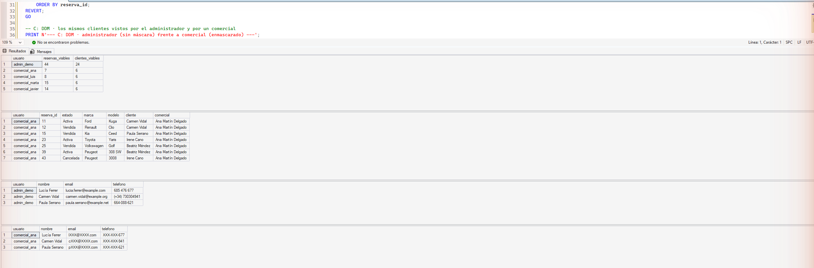

*SSMS · pestaña Mensajes con los permisos denegados (error 229)*

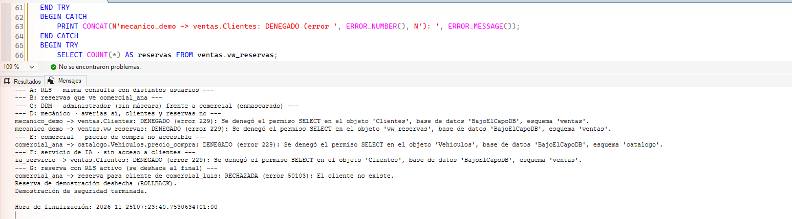

### 8.2 Optimización

**Consulta medida.** Primera página del listado: 50 SUV disponibles entre 10.000 y 15.000 €,
ordenados por precio, sobre 50.228 coches (carga temporal de 50.000).

**Mejora.** Índice compuesto
`ix_vehiculos_estado_precio (estado, precio_venta) INCLUDE (modelo_id, matricula, anio, kilometros)`.

| Métrica (segunda ejecución) | Antes | Después |
| --- | --- | --- |
| Acceso a Vehiculos | Clustered Index Scan | Index Seek |
| Otros operadores | Hash Match + TopN Sort | Nested Loops + Top |
| Filas leídas en Vehiculos | 50.228 | 209 |
| Coste estimado del plan | 2,41887 | 0,0518114 |
| Lecturas lógicas en Vehiculos | 2.974 | 5 |
| Lecturas lógicas totales | 2.988 | 523 |
| CPU / tiempo transcurrido | 16 ms / 11 ms | 0 ms / 1 ms |

**Por qué mejora.** `estado` (igualdad) delimita el rango y `precio_venta` (rango y orden) deja
las filas ya ordenadas. Así desaparece el *Sort*, y el operador *Top* se detiene tras leer 209
filas en lugar de recorrer la tabla entera. Las columnas `INCLUDE` cubren la consulta.

**El coste.** El plan pasa a un bucle anidado y suben las lecturas de Modelos (2 → 418) y Marcas
(12 → 100). Son páginas pequeñas y ya en memoria, y el total baja un 82 %. Con un rango de precios
muy amplio y sin `TOP`, la ventaja sería menor.

*SSMS · plan ANTES: Clustered Index Scan + Hash Match + Sort*

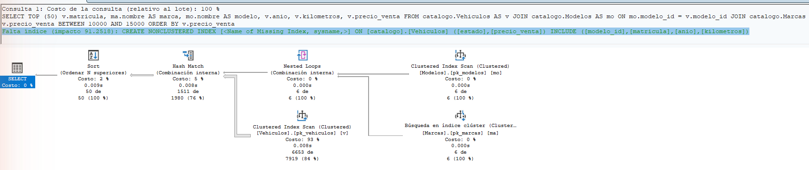

*SSMS · plan DESPUÉS: Index Seek + Nested Loops + Top*

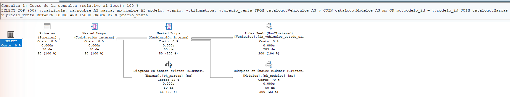

---

## 9. Funcionamiento de la parte de IA

| Aspecto | Implementación |
| --- | --- |
| Modelo de embeddings | bge-m3 en Ollama, registrado con `CREATE EXTERNAL MODEL EmbeddingsBgeM3` |
| Texto del embedding | Coches: marca, modelo, segmento, combustible y descripción. Averías: título, síntoma, causa y solución |
| Dimensión | 1024 (`VECTOR(1024)`) |
| Generación | `ia.sp_generar_embeddings` con `AI_GENERATE_EMBEDDINGS`, por lotes; solo las filas sin vector |
| Almacenamiento | Columna `embedding` en `catalogo.Vehiculos` y `taller.Averias` |
| Métrica | Distancia coseno (0 = mismo significado, 2 = opuesto): compara la dirección del vector, no su longitud, y bge-m3 está entrenado para ella |
| Búsqueda | Exacta con `VECTOR_DISTANCE`; con 228 vectores no hace falta índice vectorial |
| Modelo de respuestas | qwen2.5:3b, temperatura 0 |
| Prompt | «Responde solo con el contexto proporcionado. Si no hay datos suficientes, dilo», más: citar solo averías y costes del contexto y decir que no hay averías si la sección está vacía |

**LLM frente a RAG.**

- Un LLM solo responde con lo que recuerda de su entrenamiento y puede inventar averías o precios.
- El RAG (SQL Server + Vector Search + contexto + LLM) recupera primero las averías registradas en
  la base de datos, se las entrega al modelo como contexto y le obliga a responder solo con ellas.
  Cuando no hay datos, lo dice.

*SSMS · prueba de conexión SQL Server → Caddy → Ollama (tests/test_conexion_ia.sql)*

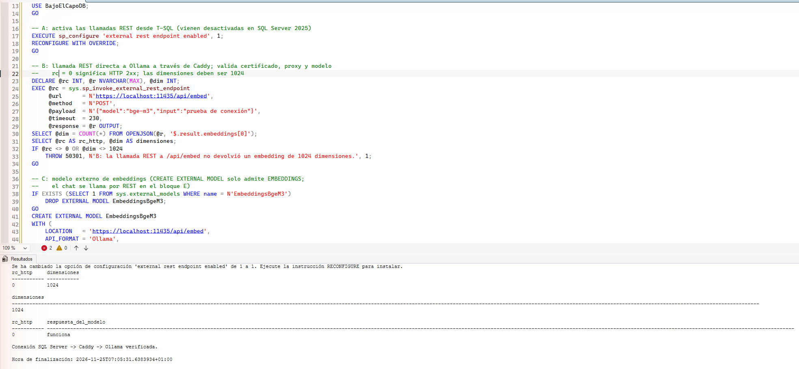

---

## 10. Capturas de resultados

Salidas reales del buscador y del asesor.

**Buscador: «familiar, económico y fiable para ciudad y escapadas»** (precio máximo 14.000 €), vía
terminal:

```text
posicion distancia marca   modelo                 segmento anio precio_venta descripcion
       1    0,4500 Peugeot 308 SW                 Familiar 2020      8500,00 Pensado para cargar de todo: bicicletas, equipaje y sillas infantiles …
       2    0,4569 Toyota  Corolla Touring Sports Familiar 2020     10150,00 Maletero enorme y plazas traseras amplias; caben carritos, maletas y l…
       3    0,4666 Seat    León                   Compacto 2018      5750,00 Tamaño justo para cinco personas, con maletero práctico y conducción a…
       4    0,4679 Peugeot 308 SW                 Familiar 2018      6000,00 Pensado para cargar de todo: bicicletas, equipaje y sillas infantiles …
       5    0,4679 Peugeot 308 SW                 Familiar 2016      4350,00 Pensado para cargar de todo: bicicletas, equipaje y sillas infantiles …
--- Comparación automática (posición, marca, modelo, precio y distancia): MISMO TOP en las dos vías
```

Ninguna descripción del catálogo contiene «familiar», «escapada», «económico» ni «fiable»: una
búsqueda por palabras clave no habría devuelto nada.

*SSMS · buscador (EXEC ia.sp_buscar_coches), frase 1*

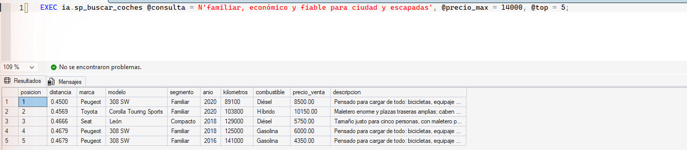

**Otras dos frases** (primeros resultados, idénticos por las dos vías):

| Frase | 1.º | 2.º | 3.º |
| --- | --- | --- | --- |
| «coche cómodo para viajes largos por autopista» | Seat León (0,3983) | Seat León (0,4021) | Seat Ateca (0,4084) |
| «aventura por caminos de tierra y fines de semana en el campo» (SUV) | Seat Ateca (0,5897) | Seat Ateca (0,5919) | Dacia Duster (0,5961) |

**Asesor (RAG): Peugeot 308 SW.** Cuatro partes: pregunta, documentos recuperados, contexto y
respuesta.

```text
=== 1. Pregunta ===
¿Qué averías suele tener y cuánto cuesta repararlas? (modelo: Peugeot 308 SW)
=== 2. Documentos recuperados ===
avería 1 · 0.5599 · Amortiguadores traseros gastados · 380 €
avería 2 · 0.5804 · Depósito de AdBlue averiado · 900 €
avería 3 · 0.5848 · Consumo excesivo de aceite (1.2 PureTech) · 2500 €
avería 4 · 0.5890 · Volante bimasa desgastado · 1200 €
avería 5 · 0.5988 · Correa de distribución en baño de aceite degradada (1.2 PureTech) · 1800 €
coche 1-3 · Peugeot 308 SW disponibles de 8500 €, 3600 € y 9950 €
=== 3. Contexto enviado al modelo ===
AVERÍAS REGISTRADAS EN BAJO EL CAPÓ PARA Peugeot 308 SW: (las 5 averías con síntoma, solución,
coste, frecuencia, gravedad y riesgo) · COCHES DISPONIBLES RELACIONADOS: (los 3 coches) · Pregunta
=== 4. Respuesta ===
El Peugeot 308 SW suele tener averías como amortiguadores traseros gastados, depósito de AdBlue
averiado, consumo excesivo de aceite, volante bimasa desgastado e una correa de distribución en el
baño de aceite degradada. Las averías más costosas son la correa de distribución, con un costo
estimado de 1800 €, y el depósito de AdBlue, con un costo estimado de 900 €.
```

*SSMS · asesor (EXEC ia.sp_asesor_averias), Peugeot 308 SW: los cuatro conjuntos de resultados*

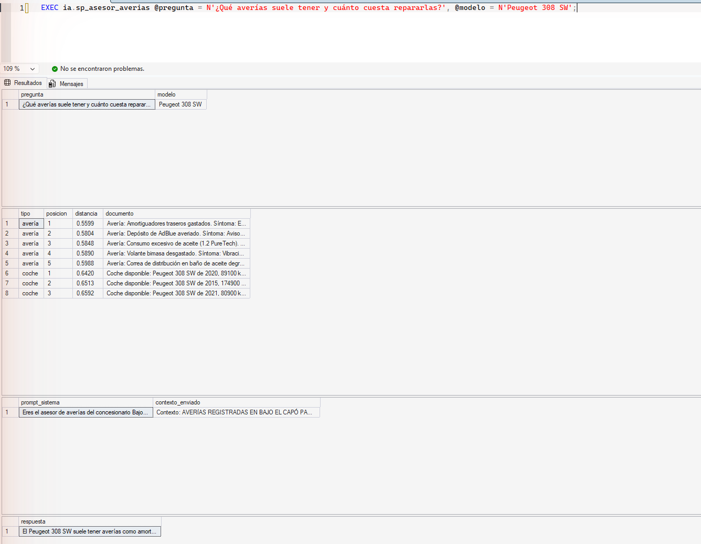

**Asesor: pregunta por síntoma**, sin modelo («Al acelerar noto tirones y el embrague patina…»).
Recupera los embragues Powershift (1600 €) y DSG7 (1800 €) como documentos más cercanos. Respuesta:

```text
Avería: Embrague de la caja DSG7 con tirones. Coste estimado: 1800 €. Modelos afectados: Seat Ibiza,
Seat León, Seat Ateca, Volkswagen Polo, Volkswagen Golf.
```

*SSMS · asesor, pregunta por síntoma sin modelo*

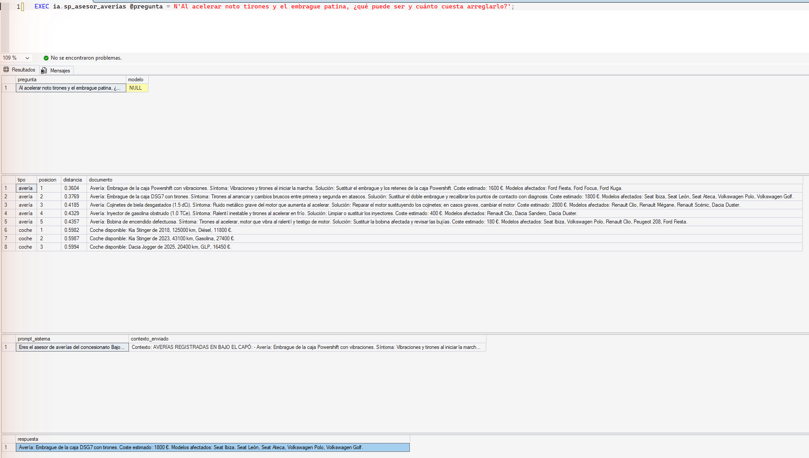

**Caso de control: Dacia Jogger**, sin averías registradas:

```text
=== 3. Contexto enviado al modelo ===
AVERÍAS REGISTRADAS EN BAJO EL CAPÓ PARA Dacia Jogger:
(ninguna)
COCHES DISPONIBLES RELACIONADOS:
- Coche disponible: Dacia Jogger de 2025, 20400 km, GLP, 16450 €.
- Coche disponible: Dacia Jogger de 2026, 19400 km, GLP, 19100 €.
- Coche disponible: Dacia Jogger de 2022, 63500 km, GLP, 10000 €.
=== 4. Respuesta ===
No hay averías registradas para ese modelo.
```

En los tres casos, el prompt y el contexto enviados por la vía SSMS y por la vía terminal son
idénticos (comprobado automáticamente).

*SSMS · caso de control: Dacia Jogger*

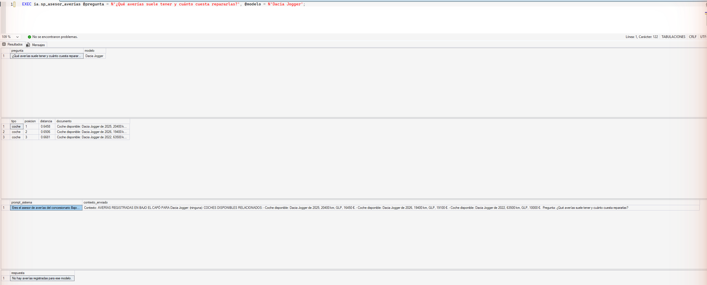

---

## 11. Problemas encontrados

| Problema | Causa | Solución |
| --- | --- | --- |
| SQL Server no podía llamar a Ollama | SQL Server solo admite HTTPS para modelos externos | Proxy local Caddy con `tls internal` y confianza en su certificado en el almacén del equipo |
| El índice filtrado fallaba al crear las tablas (error 1934) | `sqlcmd` desactiva `QUOTED_IDENTIFIER` por defecto | `sqlcmd -I` en `run_all.ps1` |
| La lista de averías de la ficha JSON salía como texto escapado | `JSON_ARRAYAGG` con `ORDER BY` dentro de una subconsulta | `CAST((subconsulta) AS JSON)` |
| El script de seguridad fallaba al repetirlo (error 16007) | `DROP MASKED` se valida al compilar el lote | Quitar las máscaras con SQL dinámico |
| Una reserva de la demostración se guardaba de verdad | El `ROLLBACK` del procedimiento deshacía también la transacción externa | Sacar de la transacción el intento que debe fallar |
| Acentos rotos al enviar las frases desde PowerShell | PowerShell 5.1 lee como ANSI los `.ps1` sin BOM | Guardar los `.ps1` en UTF-8 con BOM |
| `"stream": false` no se podía construir en el JSON | `CAST('false' AS JSON)` no es válido | `JSON_MODIFY(..., CAST(0 AS BIT))` |
| La propuesta preveía qwen2.5:7b como modelo de respuestas | La propuesta ya contemplaba un modelo de 3B como alternativa más ligera | Se usa qwen2.5:3b: con prompt restrictivo y temperatura 0 cumple, incluido el caso de control |

---

## 12. Conclusiones

SQL Server 2025 permite construir un RAG completo dentro de la base de datos, en local y sin
secretos. Concentra los datos, la seguridad, los vectores y la recuperación, y delega en un modelo
local solo los embeddings y la redacción de la respuesta. La seguridad sigue aplicándose a la IA:
los perfiles de negocio la usan mediante `EXECUTE AS`, sin permisos sobre el modelo, y RLS y las
máscaras protegen los datos de clientes.

Los resultados lo demuestran:

- La optimización reduce las lecturas lógicas en `Vehiculos` de 2.974 a 5.
- El buscador encuentra coches por significado y no por palabras.
- El asesor no inventa averías cuando no hay datos.
- Todo se reproduce desde cero con un único comando.

**Qué se ha aprendido.**

- Integrar modelos locales en SQL Server mediante HTTPS.
- Elegir y justificar la métrica de similitud.
- Medir una optimización con el plan real en lugar del tiempo.
- Que un buen prompt y un contexto acotado importan más que el tamaño del modelo para evitar
  respuestas inventadas.

**Mejoras.**

- Índice vectorial DiskANN y `VECTOR_SEARCH` cuando salgan de vista previa.
- Búsqueda híbrida (palabras clave + vectores).
- Fragmentación de textos largos con `AI_GENERATE_CHUNKS`.
- Una interfaz mínima para los comerciales.
- Pruebas automatizadas con tSQLt en integración continua.
