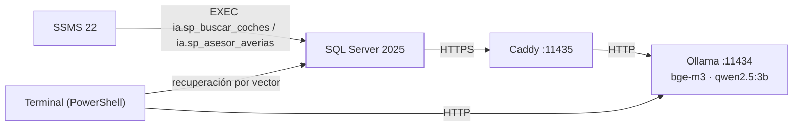

# Bajo el Capó

## Buscador semántico y asesor de averías para un concesionario de coches de segunda mano

| | |
| --- | --- |
| **Autor** | Emmanuel Grande Sierra |
| **Certificación** | Microsoft DP-800 · SQL AI Developer Associate |
| **Práctica** | Práctica 09 · Mini-proyecto de BD vectoriales |
| **Nivel** | Nivel 3 (Avanzado) |
| **Fecha** | 29 de octubre de 2026 |
| **Repositorio** | [ENLACE AL REPOSITORIO DE GITHUB] |

---

## 1. Portada

Este documento es el informe técnico de *Bajo el Capó*. Es una solución local con SQL Server 2025
y Ollama que combina diseño de bases de datos, seguridad, optimización e inteligencia artificial
dentro de la propia base de datos: embeddings, búsqueda vectorial y RAG. El código completo y las
salidas de ejecución están en el repositorio. Aquí se explica qué se hizo, por qué y con qué
resultados.

---

## 2. Objetivo del proyecto

Diseñar, implementar, documentar y demostrar una base de datos SQL Server 2025 que cubra los siete
bloques del enunciado (A a G) y alcance el **nivel 3**: Nivel 2 + Vector Search + RAG + modelo
local. Objetivos concretos:

- Modelo relacional con relaciones 1:N, N:M y 1:1, restricciones, índices y objetos de
  programación.
- Seguridad con tres mecanismos: mínimo privilegio, Row-Level Security y Dynamic Data Masking.
- Optimización medida con el plan de ejecución real y las lecturas lógicas.
- Embeddings locales (bge-m3) guardados en `VECTOR(1024)`.
- Buscador semántico con ranking por distancia coseno.
- RAG con un modelo local (qwen2.5:3b) que responde solo con datos recuperados.
- Dos vías de uso (SSMS y terminal) con la misma lógica de recuperación.
- Desarrollo asistido por IA (Claude Code + GitHub Spec Kit) documentado y verificado.
- Todo reproducible con un comando: `run_all.ps1 -ConIA`.

---

## 3. Caso de uso

*Bajo el Capó* es un concesionario ficticio de coches de segunda mano con un problema de dos caras:

- **El comprador** no sabe de mecánica. Ve anuncios muy parecidos y no sabe qué averías son típicas
  de cada modelo ni cuánto le costarán.
- **El concesionario** pierde ventas por falta de confianza, o vende coches que después generan
  reclamaciones.

Ejemplo: Marta busca un coche familiar por menos de 14.000 €. Con el buscador, el comercial escribe
lo que Marta pide con sus propias palabras y obtiene coches parecidos en significado. Con el asesor,
le explica las averías registradas del modelo elegido y su coste antes de firmar.

| Usuario | Qué necesita | Qué puede hacer en el sistema |
| --- | --- | --- |
| Comercial | Encontrar el coche que encaja y argumentar con datos | Catálogo sin precio de compra, buscador, asesor, sus reservas y sus clientes |
| Mecánico | Conocer las averías de cada modelo | Modelos, averías y asesor; nada de datos comerciales |
| Administrador | Control total | Todo, incluidos los datos sin máscara |
| Servicio de IA | Llamar a los modelos | Usar el modelo externo y leer el contexto; ni clientes ni escrituras |

---

## 4. Arquitectura

La solución tiene tres capas. El usuario trabaja desde SSMS o desde la terminal. SQL Server
concentra los datos, la seguridad, los vectores y la recuperación. Ollama aporta los embeddings y
las respuestas.



- **Vía SSMS**: todo ocurre dentro de SQL Server. El procedimiento genera el embedding con
  `AI_GENERATE_EMBEDDINGS`, busca con `VECTOR_DISTANCE`, construye el contexto y llama al modelo de
  chat con `sp_invoke_external_rest_endpoint`. SQL Server solo admite HTTPS para modelos externos;
  por eso Caddy expone Ollama en `https://localhost:11435` con un certificado local (`tls internal`).
- **Vía terminal**: `ai/buscar_coches.ps1` y `ai/asesor_averias.ps1` piden el embedding y la
  respuesta a Ollama directamente y usan SQL Server para la recuperación. El ranking y el contexto
  se calculan en T-SQL con las mismas funciones que la vía SSMS.

[CAPTURA: diagrama de arquitectura del README dibujado en GitHub]

---

## 5. Modelo de datos

Base `BajoElCapoDB` (intercalación `Modern_Spanish_CI_AS`, nivel de compatibilidad 170) con cinco
esquemas: `catalogo`, `taller`, `ventas`, `ia` y `seg`. No hay ningún objeto del proyecto en `dbo`.

| Tabla | Filas | Descripción |
| --- | --- | --- |
| catalogo.Marcas | 8 | Marcas y país |
| catalogo.Modelos | 24 | Modelos con segmento y años de producción |
| catalogo.Vehiculos | 228 | Coches en stock: matrícula, precios, descripción, equipamiento (JSON), estado y embedding |
| taller.Averias | 57 | Averías conocidas: síntoma, causa, solución, coste y embedding |
| taller.ModeloAveria | 207 | Qué averías tiene cada modelo, con frecuencia y gravedad (1 a 5) |
| ventas.Comerciales | 4 | Comerciales y su usuario de base de datos (para RLS) |
| ventas.Clientes | 24 | Clientes asignados a un comercial |
| ventas.Reservas | 44 | Reservas (Activa, Cancelada o Vendida) |
| ventas.Ventas | 16 | Ventas cerradas, una por reserva |

Relaciones:

- Marcas–Modelos y Modelos–Vehículos: 1:N.
- Modelos–Averías: N:M a través de ModeloAveria.
- Comerciales–Clientes y Clientes–Reservas: 1:N.
- Reservas–Ventas: 1:1.

Restricciones destacadas:

- Matrícula y email validados con `REGEXP_LIKE`.
- CHECK de segmentos, estados, años, kilómetros, precios, frecuencia y gravedad.
- Un índice único filtrado impide dos reservas activas sobre el mismo coche.
- El **Dacia Jogger** no tiene averías registradas: es el caso de control del RAG.

[CAPTURA: diagrama de base de datos de SSMS con las 9 tablas y sus relaciones]

---

## 6. Funcionalidades implementadas

| Bloque | Implementación |
| --- | --- |
| A · Diseño y T-SQL | 9 tablas; 3 vistas (`vw_catalogo` no expone el precio de compra); funciones `fn_coste_esperado` y `fn_averias_modelo`; procedimientos `sp_registrar_reserva` y `sp_registrar_venta` con transacción, bloqueo `UPDLOCK, HOLDLOCK` y `THROW` 501xx; trigger `tr_reservas_estado`; consultas avanzadas (CTE, window functions, correlacionada, JSON y regex) |
| B · IA como asistente | Claude Code + GitHub Spec Kit: constitución, y spec, plan y tareas de las 6 features; 5 casos documentados en `docs/bloque-b.md` |
| C · Seguridad | 4 roles, 7 usuarios sin inicio de sesión, `GRANT`/`DENY`, RLS y DDM |
| D · Optimización | Índice compuesto para el listado del catálogo, medido con 50.228 coches |
| E · Embeddings | Modelo externo bge-m3; 228 coches y 57 averías en `VECTOR(1024)` |
| F · Intelligent Search | Ranking por distancia coseno con filtros, por dos vías |
| G · RAG | Asesor de averías con las cuatro partes visibles y caso de control, por dos vías |

### 6.1 Estrategia de pruebas

Cada prueba lanza `THROW` con un código 500xx si falla, y `run_all.ps1` se detiene en el primer
error. La ejecución completa desde cero (`run_all.ps1 -ConIA`) termina con «RESULTADO: todos los
scripts y tests terminaron sin errores».

| Tipo | Qué comprueba | Bloque de tests |
| --- | --- | --- |
| Estructurales | 9 tablas, reparto por esquema, nada en `dbo` | `tests.sql` A, B |
| De datos | Recuentos exactos y coherencia entre coches, reservas y ventas | `tests.sql` C, D |
| De objetos | Vistas y funciones devuelven filas; el catálogo no expone el precio de compra | `tests.sql` E |
| De integración | Reserva → venta con el trigger y limpieza | `tests.sql` F |
| Negativas | Doble reserva (50102), precio inválido (50113), permiso denegado al mecánico (229), caso de control del RAG | `tests.sql` F, G; `tests_ia.sql` K |
| De seguridad | Roles, RLS activa, columnas enmascaradas, filas distintas por comercial | `tests.sql` G |
| De rendimiento | El índice existe y la carga temporal se ha borrado | `tests.sql` H |
| De IA | Vectores completos de 1024 dimensiones, ranking con filtros, RAG limitado al modelo | `tests_ia.sql` I, J, K |
| De equivalencia | Mismo top y mismo contexto por las dos vías | scripts de evidencia 004 y 005 |

Como mejora queda migrar las pruebas a tSQLt o a SQL Database Projects con integración continua.

[CAPTURA: salida final de run_all.ps1 -ConIA en la terminal con todos los bloques en OK]

---

## 7. Consultas o código más importante

**Las 3 averías más frecuentes de cada modelo** (CTE + window function):

```sql
WITH ranking AS (
    SELECT marca, modelo, titulo, frecuencia, gravedad,
           ROW_NUMBER() OVER (PARTITION BY modelo_id ORDER BY frecuencia DESC, gravedad DESC) AS posicion
    FROM taller.vw_averias_por_modelo)
SELECT marca, modelo, posicion, titulo FROM ranking WHERE posicion <= 3;
```

**Reserva sin conflictos**: `sp_registrar_reserva` bloquea el coche con `UPDLOCK, HOLDLOCK` dentro
de la transacción. Si el coche no está disponible, lanza `THROW 50102`. El trigger
`tr_reservas_estado` recalcula el estado del coche a partir de todas sus reservas.

**Ranking semántico compartido** (`ia.fn_ranking_coches`, núcleo de las dos vías):

```sql
SELECT TOP (@top) ..., VECTOR_DISTANCE('cosine', v.embedding, @vector) AS distancia
FROM catalogo.Vehiculos AS v ...
WHERE v.estado = N'Disponible'
  AND (@precio_max IS NULL OR v.precio_venta <= @precio_max)
  AND (@segmento IS NULL OR mo.segmento = @segmento)
ORDER BY distancia;
```

**Uso de la IA sin permisos sobre el modelo**: `ia.sp_buscar_coches` e `ia.sp_asesor_averias` se
declaran `WITH EXECUTE AS 'ia_servicio'`. Comerciales y mecánicos solo tienen `EXECUTE` sobre el
esquema `ia`.

El resto del código está en `database/`, `ai/` y `tests/`.

---

## 8. Seguridad y optimización

### Seguridad

| Mecanismo | Implementación | Resultado demostrado |
| --- | --- | --- |
| Mínimo privilegio | Roles por perfil; acceso por vistas y procedimientos; `DENY` del esquema `ventas` al mecánico y al servicio de IA | El mecánico recibe el error 229 al consultar clientes o reservas; el comercial, al leer la tabla de vehículos (precio de compra) |
| Row-Level Security | Predicado `seg.fn_predicado_comercial` (`USER_NAME()` = `usuario_bd`) con FILTER y BLOCK en clientes y reservas | Misma consulta: admin 44 reservas; comercial_ana 7; comercial_luis 8; comercial_marta 15; comercial_javier 14. Reservar para un cliente ajeno da el error 50103 |
| Dynamic Data Masking | `email()` y `partial(0,"XXX-XXX-",3)`; `UNMASK` solo para el administrador | admin ve `lucia.ferrer@example.com` / `685 476 677`; el comercial ve `lXXX@XXXX.com` / `XXX-XXX-677` |

[CAPTURA: tests/demo_seguridad.sql en SSMS, bloque A (filas por usuario) y bloque C (máscaras)]

[CAPTURA: tests/demo_seguridad.sql en SSMS, mensajes con los permisos denegados]

### Optimización

Consulta: primera página del listado (50 SUV disponibles entre 10.000 y 15.000 €, ordenados por
precio), con 50.228 coches. Mejora: índice compuesto
`ix_vehiculos_estado_precio (estado, precio_venta) INCLUDE (modelo_id, matricula, anio, kilometros)`.

| Métrica (segunda ejecución) | Antes | Después |
| --- | --- | --- |
| Acceso a Vehiculos | Clustered Index Scan | Index Seek |
| Filas leídas en Vehiculos | 50.228 | 209 |
| Coste estimado del plan | 2,41887 | 0,0518114 |
| Lecturas lógicas Vehiculos | 2.974 | 5 |
| Lecturas lógicas totales | 2.988 | 523 |
| CPU / tiempo transcurrido | 16 ms / 11 ms | 0 ms / 1 ms |

**Por qué mejora.** `estado` (igualdad) delimita el rango y `precio_venta` (rango y orden) deja
las filas ya ordenadas. Así el operador Top para tras leer 209 filas, sin ordenar ni recorrer la
tabla. Las columnas INCLUDE evitan los *key lookups*. **El precio**: el plan pasa a bucle anidado y
suben las lecturas de Modelos (2 → 418) y Marcas (12 → 100). Son páginas pequeñas en memoria y el
total baja un 82 %. Si se pidieran todas las filas de un rango muy amplio, la ventaja sería menor.

[CAPTURA: plan de ejecución gráfico ANTES (Clustered Index Scan + Sort) abierto desde docs/evidencias/003-plan-antes.sqlplan]

[CAPTURA: plan de ejecución gráfico DESPUÉS (Index Seek + Top) abierto desde docs/evidencias/003-plan-despues.sqlplan]

---

## 9. Funcionamiento de la parte de IA

| Aspecto | Implementación |
| --- | --- |
| Modelo de embeddings | bge-m3 en Ollama, registrado con `CREATE EXTERNAL MODEL EmbeddingsBgeM3` (API_FORMAT Ollama, MODEL_TYPE EMBEDDINGS) |
| Texto del embedding | Coches: marca, modelo, segmento, combustible y descripción. Averías: título, síntoma, causa y solución |
| Dimensión | 1024 (`VECTOR(1024)`) |
| Generación | `ia.sp_generar_embeddings` con `AI_GENERATE_EMBEDDINGS`, por lotes en transacciones independientes; si Ollama falla, lo ya hecho se conserva |
| Almacenamiento | Columna `embedding` en `catalogo.Vehiculos` y `taller.Averias` |
| Métrica | Distancia coseno, de 0 (mismo significado) a 2 (opuesto). Compara la dirección del vector y no su longitud; bge-m3 está entrenado para ella |
| Búsqueda | Exacta con `VECTOR_DISTANCE` (228 vectores); el índice vectorial y `VECTOR_SEARCH` siguen en vista previa |
| Modelo de respuestas | qwen2.5:3b, temperatura 0, `stream` false |
| Prompt | «Responde solo con el contexto proporcionado. Si no hay datos suficientes, dilo», más: citar solo averías y costes del contexto, decir que no hay averías si la sección está vacía, y máximo cinco frases |

**Buscador.** Las tres frases de prueba dan resultados coherentes:

- «familiar, económico y fiable para ciudad y escapadas» (≤ 14.000 €): sale primero un Peugeot
  308 SW descrito como «pensado para cargar de todo: bicicletas, equipaje y sillas infantiles»,
  a una distancia de 0,4500.
- «coche cómodo para viajes largos por autopista»: León y Passat «gran rodadora».
- «aventura por caminos de tierra…» (SUV): Ateca y Duster «robusto y práctico para rutas por
  montaña».

Ninguna de las cinco descripciones del primer ranking contiene las palabras de la frase. La búsqueda
por palabras clave de `08` (bloque E2) solo encuentra textos con esas palabras. Una comparación
automática confirma que las dos vías devuelven el **mismo top** para las tres frases.

**RAG.** Pregunta → embedding → búsqueda vectorial de las averías (limitada al modelo mediante
`ModeloAveria`) y de coches disponibles → contexto → qwen2.5:3b → respuesta. Las cuatro partes son
visibles en las dos vías. El contexto y el prompt se construyen en T-SQL, así que las dos vías
envían exactamente lo mismo (comprobado automáticamente).

**LLM frente a RAG.** Un LLM solo responde con lo que recuerda de su entrenamiento y puede inventar
averías o precios. El RAG (SQL Server + Vector Search + contexto + LLM) responde con las averías
registradas en la base de datos y, cuando no hay datos, lo dice. En el caso de control (Dacia
Jogger), el contexto indica «(ninguna)» y la respuesta es «No hay averías registradas para ese
modelo.».

---

## 10. Capturas de resultados

Las salidas completas están en `docs/evidencias/`:

- `000-conexion-ia.txt`: cadena SQL Server → Caddy → Ollama.
- `001-base-datos.txt`: run_all y consultas avanzadas.
- `002-seguridad.txt`.
- `003-optimizacion.md`, `.txt` y los dos `.sqlplan`.
- `004-busqueda.txt`.
- `005-rag.txt`.

[CAPTURA: SSMS con EXEC ia.sp_buscar_coches y la frase «familiar, económico y fiable para ciudad y escapadas», precio máximo 14000]

[CAPTURA: terminal con .\ai\buscar_coches.ps1 y la misma frase, mostrando el mismo top]

[CAPTURA: SSMS con EXEC ia.sp_asesor_averias sobre el Peugeot 308 SW: los cuatro conjuntos de resultados]

[CAPTURA: terminal con .\ai\asesor_averias.ps1 sobre el Dacia Jogger: respuesta «No hay averías registradas para ese modelo.»]

[CAPTURA: resultado de una consulta avanzada de 08 (las 3 averías más frecuentes por modelo)]

---

## 11. Problemas encontrados

| Problema | Causa | Solución |
| --- | --- | --- |
| `02` fallaba al crear el índice filtrado (error 1934) | sqlcmd desactiva `QUOTED_IDENTIFIER` por defecto | `sqlcmd -I` en `run_all.ps1` |
| El campo `averias_top` de la ficha JSON salía como texto escapado | `JSON_ARRAYAGG` con `ORDER BY` dentro de una subconsulta; `JSON_QUERY` no bastaba | `CAST((subconsulta) AS JSON)` |
| Error 16007 al repetir el script de seguridad | `DROP MASKED` se valida al compilar el lote | Quitar las máscaras con SQL dinámico |
| La reserva de la demo de seguridad se comitió de verdad | El `ROLLBACK` del `CATCH` del procedimiento deshizo la transacción externa | Mover el intento que falla fuera de la transacción y borrar la reserva |
| `tests_ia.sql` no compilaba (error 113) | La cabecera contenía `ai/*.sql` y abría un comentario anidado | Reescribir la cabecera |
| Frases con acentos rotos («económico») | PowerShell 5.1 lee como ANSI los `.ps1` sin BOM | Guardar los `.ps1` en UTF-8 con BOM |
| `"stream": false` en el JSON del chat | `CAST('false' AS JSON)` no es válido | `JSON_MODIFY(..., CAST(0 AS BIT))` |

Los casos completos del bloque B están en `docs/bloque-b.md` y las decisiones en
`docs/decisiones.md`.

---

## 12. Conclusiones

SQL Server 2025 permite construir un RAG completo dentro de la base de datos, en local y sin
secretos. Concentra los datos, la seguridad, los vectores y la recuperación, y delega en un modelo
local solo los embeddings y la redacción de la respuesta. La seguridad sigue aplicándose a la IA:
los perfiles de negocio la usan mediante `EXECUTE AS`, sin permisos sobre el modelo, y RLS y DDM
protegen los datos de clientes.

Las cifras del proyecto salen de ejecuciones reales:

- La optimización reduce las lecturas en `Vehiculos` de 2.974 a 5.
- El buscador encuentra coches por significado y no por palabras.
- El asesor no inventa averías cuando no hay datos.

El desarrollo con Claude Code y Spec Kit aceleró el trabajo, pero no sustituye la verificación. Los
cinco casos del bloque B muestran código generado que hubo que corregir tras ejecutarlo y probarlo.

**Mejoras**:

- Índice vectorial DiskANN y `VECTOR_SEARCH` cuando salgan de vista previa.
- Búsqueda híbrida.
- Fragmentación con `AI_GENERATE_CHUNKS`.
- Una interfaz mínima para los comerciales.
- Pruebas automatizadas con tSQLt en integración continua.
